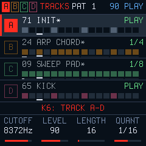

# SMKSYNTH

**O SMK‑37 Pro como instrumento de performance.**

[Site e instalação](https://smksynth.padrini.chatgpt.site/) · [Simulador](https://smksynth.padrini.chatgpt.site/simulator/) · [Backup e restauração](https://smksynth.padrini.chatgpt.site/backup/) · [Instalação](docs/INSTALLATION.md) · [English](docs/README.en.md)

Do ponto de vista sonoro, o SMKSYNTH é o casamento do excelente sintetizador [OberVave](https://github.com/zvenson/obervave) com a engine DRUM-X do também excelente [JIANT](https://github.com/juanjiant-bit/JIANT).

Porém, um instrumento é muito mais que o som. A ideia aqui é transformar o M‑VAVE SMK‑37 Pro em um instrumento voltado para a performance, criando recursos e reimaginando uma experiência que usa os pads e controles do teclado.

Alterne entre partes, grave e acesse timbres favoritos com um toque, grave sequências, faça layers e splits, salve cenas e recupere seu conjunto com um botão. Os pads são o coração do SMKSYNTH: este projeto traduz minha visão de um instrumento para performance nesse formato compacto de 37 teclas.

— **Marcus Padrini** · conceito de performance, adaptações, seleção de sons e patterns

## O que está incluído

| Recurso | SMKSYNTH 1.0.0 |
|---|---|
| Partes | Quatro, com seleção de ANALOG ou DRUM-X por parte |
| Synth ANALOG | OberVave; oito vozes compartilhadas |
| Bateria | DRUM-X; oito instrumentos por kit |
| Performance | Favoritos, sends por parte, split/layer e transpose de sequências pelas teclas |
| Sequenciador | Quatro tracks; até 256 steps por track; gravação ao vivo ou passo a passo |
| Patterns/cenas | 16 posições; sequência, sons, mixer e configurações de teclado por pattern |
| Conteúdo inicial | Cinco patterns de Marcus Padrini e oito favoritos |
| Presets | Banco da base mantido; nenhum preset de usuário extra instalado |
| Salvamento | Manual; backup/restauração pelo navegador |

Os sons editados das cenas e favoritos ficam nos próprios snapshots, sem depender de presets extras. Patterns 6–16 começam livres. O tempo inicial dos exemplos é 90 BPM.

## Pads persistentes

KNOB BANK escolhe o banco de pads. PLAY, REC, seleção de engine e mudança de página não tomam essa escolha automaticamente. SEQ acessa explicitamente os steps do sequenciador.

| Banco | Uso |
|---|---|
| Performance / Favoritos | Pads superiores: partes A–D, delay/reverb e −/+ preset. Inferiores: oito favoritos. Toque recupera; segure para memorizar. |
| Split / Layer | Duas configurações independentes; escolha partes, SINGLE/SPLIT/LAYER e a linha tocada. |
| Patterns / Save | Toque carrega um dos 16 patterns; segure para salvar. Posição ocupada pede confirmação. |
| Drum Pads | Entra no ciclo apenas com DRUM-X selecionado. Oito pads superiores tocam/gravam bateria com velocity; inferiores reservados. |

Drum Pads usam violeta em repouso e branco no toque ou nos hits da sequência. Trocar para ANALOG preserva esse banco, inativo. Selecionar uma voz de bateria, sozinho, **não** transforma os pads em bateria.

## Instalação: M‑VAVE oficial V016 obrigatória

**Instalação inicial somente para SMK‑37 Pro executando M‑VAVE oficial V016, identidade `SMK-37 Pro_016`.** Elite, MKE-P37, FM-1, outras versões e firmwares alternativos são recusados pelo instalador.

1. Guarde seu trabalho. Se já usa SMKSYNTH, exporte o banco antes de retornar ao firmware oficial.
2. Instale a V016 para **SMK‑37 Pro**, obtida na [página oficial M‑VAVE](https://www.cuvave.com/appdownload), usando M‑UPGRADE.
3. Abra o [instalador SMKSYNTH](https://smksynth.padrini.chatgpt.site/install/) em Chrome/Edge no computador, com cabo USB de dados e alimentação estável. Feche outros aplicativos MIDI.
4. Consulte a identidade, confira a confirmação e aguarde a identidade final `SMK-37 Pro_19618`.
5. O primeiro boot abre Pattern 1, parado. PLAY toca o exemplo; KNOB BANK → Patterns dá acesso a P1–P5. Os oito favoritos estão nos pads inferiores de Performance.

Este pacote prepara o banco de fábrica: **não é um atualizador que preserve o banco de uma versão anterior do SMKSYNTH**. Uma transferência interrompida pode ser retomada pelo mesmo instalador, navegador e pacote. A primeira instalação não é atômica; o loader mantém a retomada até concluir. O firmware oficial M‑VAVE não é redistribuído aqui.

[Instruções completas, recuperação e retorno à M‑VAVE](docs/INSTALLATION.md).

## Fonte, validação e estado do lançamento

A experiência DP2 foi testada e aprovada por Marcus no SMK‑37 Pro. A 1.0.0 acrescenta conteúdo de fábrica e o pacote de primeira instalação. **M‑VAVE V016 → 1.0.0** foi testado com o arquivo oficial fornecido, em flash simulada, incluindo interrupções. Sua confirmação por USB no instrumento real permanece pendente antes do lançamento público.

Repositório e site de revisão permanecem privados até a aprovação da publicação. Nenhuma release pública ou tag de lançamento foi criada nesta preparação.

- [Validação e hashes](docs/VALIDATION.md)
- [Build a partir das fontes](docs/BUILD.md)
- [Mudanças](CHANGELOG.md)
- [Contribuir](CONTRIBUTING.md)
- [Guia de uso](docs/USER_GUIDE.md)

O simulador executa o mesmo código C de síntese, sequenciamento e interface em WebAssembly. Tem memória independente e começa com os mesmos cinco patterns e oito favoritos da instalação.

## Créditos e licença

OberVave e Dinghy: **zvenson**. JIANT / DRUM-X: **Juan Ignacio Antonucci (Juan Jiant)** e colaboradores. Felucca: **Leo Kuroshita / Hügelton Instruments**. SLOOP: **isod89** e colaboradores. Port/ferramentas SMK-37: **M. Geisler / genkigenki** e colaboradores. SMKSYNTH: **Marcus Padrini**.

Firmware e adaptações sob **GPL-3.0-only**. Consulte [LICENSE](LICENSE), [CREDITS](CREDITS.md) e [LICENSING](LICENSING.md) para atribuições e licenças de componentes. Não há samples de terceiros nesta distribuição. Projeto independente, sem vínculo ou endosso da M‑VAVE ou dos autores dos projetos de origem.
