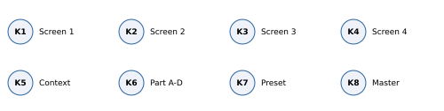
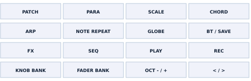
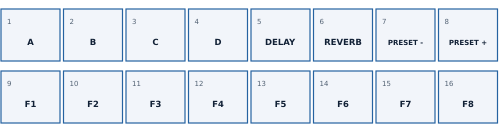
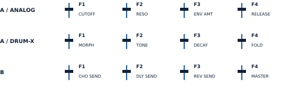
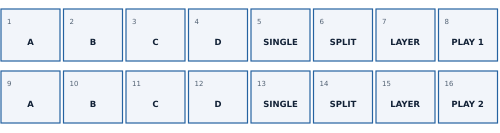
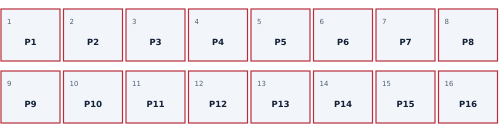
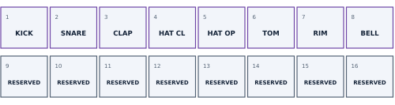
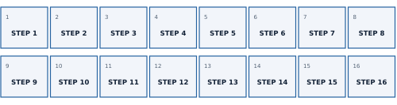
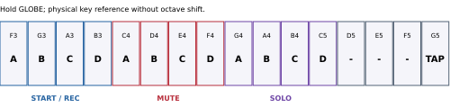

# SMKSYNTH 1.0.0 - Complete manual

[PDF](pdf/SMKSYNTH-1.0.0-Manual-EN.pdf) · [Português](MANUAL.md) · [English](MANUAL.en.md)

Reference: firmware 1.0.0, SMK-37 Pro_19618.

## Contents

- 1. Overview and navigation
- 2. Buttons: reference
- 3. Performance, faders and wheels
- 4. Favourites and presets
- 5. Split and Layer
- 6. Patterns and scenes
- 7. DRUM-X and Drum Pads
- 8. Live and step recording
- 9. Sequencer: views and controls
- 10. Transpose and held commands
- 11. ANALOG: oscillators, filter and envelopes
- 12. LFO, arpeggiator, polyphony and output
- 13. Effects and mixer
- 14. GLOBAL and MIDI
- 15. Saving, installation and backup
- 16. Simulator, troubleshooting and reference
- MIDI appendix / 1
- MIDI appendix / 2
- MIDI appendix / 3

## AI-assisted development

Developed using AI: Marcus Padrini defined and directed the experience, created the patterns and tested on hardware. ChatGPT (OpenAI) contributed technical solutions and generated and revised code, tools, documentation and graphics. Original engines: authors in CREDITS.md. No OpenAI endorsement.

## 1. Overview and navigation

Firmware 1.0.0 for M-VAVE SMK-37 Pro. Four parts A-D; ANALOG (OberVave) or DRUM-X per part. Eight shared ANALOG voices. 16 patterns; up to 256 steps per track and four notes per ANALOG step.

K1-K4 edit the labels shown on screen. K6 selects part, K7 preset, K8 physical master. K5 is contextual: tempo on Performance and ordinary pages, page/bar in STEPS, next pattern in other SEQ views and Mixer, LEVEL/OCT in Split/Layer.

Pad bank and display page are separate states. PLAY, REC and engine selection do not automatically choose another bank. SEQ explicitly requests steps; KNOB BANK returns to the manual cycle.

| Bank | Entry | Purpose |
| --- | --- | --- |
| 1 | KNOB BANK | Performance and eight favourites |
| 2 | KNOB BANK | Two Split/Layer rows |
| 3 | KNOB BANK | 16 patterns/scenes and save |
| 4 | KNOB BANK + DRUM-X | Play/record eight instruments |
| SEQ | SEQ | 16 steps in the page |

Tap = press and release. Hold = keep pressed for the stated time. Pad diagrams use two rows of eight, left to right: 1-8 above, 9-16 below. Other drawings are functional maps, not to scale.

## 2. Buttons: reference

| Button | Function |
| --- | --- |
| PATCH | Tap: Performance; on Performance opens Mixer; in Mixer cycles seven rows. Hold 0.7 s: return to Performance. |
| PARA | Tap: synthesis pages; in STEPS clears and advances a step (DRUM: clears the lane hit). Hold: edit/erase layer. |
| CHORD | ANALOG: FILTER ENV / AMP ENV. DRUM-X: DRUM SOUND. |
| NOTE REPEAT | ANALOG: LFO / LFO DEST / LFO +. DRUM-X redirects to DRUM SOUND. |
| ARP | Open ARP. Another tap on that page toggles the part’s HOLD. |
| SCALE | Hold in ANALOG STEPS: STEP+. On GLOBAL, tap toggles SYNC AUTO / INTERNAL. |
| GLOBE | Tap: GLOBAL > POLYPHONY > OUTPUT > PART SETUP. Hold: keys for start/stop, mute, solo and tap tempo. |
| BT / SAVE | Tap: save the part preset to its current program. Hold 0.7 s: SAVE PRESET AS; K7 chooses destination, BT confirms. |
| FX | Tap: CHORUS > DELAY > REVERB > DRIVE. Hold: K1/K2/K3 chorus/delay/reverb returns; K4 delay time. |
| SEQ | Tap: sequencer views and explicit step-pad ownership. Hold: white keys become steps. |
| PLAY | Start from step 1 or stop. Stopping also ends REC. |
| REC | Tap: arm while stopped; toggle recording while running. Hold over 1.2 s: clear selected track. |
| KNOB BANK | Tap: cycle pad banks. Hold 0.7 s: Performance/Favourites. From SEQ, one tap returns to Performance. |
| FADER BANK | Toggle fader bank A / B; lit LED means B. Does not change the pad bank. |
| OCT - / + | Selected part octave: -2 to +2; both together reset. While holding SEQ: page; while holding PARA: undo/redo. |
| < / > | 16-step page for the selected track, within its configured length. |

## 3. Performance, faders and wheels

|  | K1 | K2 | K3 | K4 |
| --- | --- | --- | --- | --- |
| ANALOG | CUTOFF | RESO | ENV AMT | RELEASE |
| DRUM-X | MORPH | TONE | DECAY | FOLD |
| KEY TRANS ON | Normal | Normal | Normal | KEY TR |

Pads 1-4 select A-D. Pads 5/6 disable or restore the part’s delay/reverb sends. Pads 7/8 change preset. When KEY TRANS is enabled, K4 shows KEY TR instead of Release/Fold; turn left to disable capture.

Fader Bank A controls the selected part on every page. Bank B: F1-F3 are per-part sends; move through the stored value for pickup to engage. F4 and K8 control the same physical master. This differs from VOL on the Mixer MASTER row.

Physical Pitch and Mod follow the selected part. Pitch uses the sound’s BEND range; Mod adds vibrato. Held notes retain their correct note-offs when changing parts.

## 4. Favourites and presets

1. Select a part with K6 or pad 1-4 and adjust the sound.
2. To store, hold one of pads 9-16 for 0.7 s.
3. Stop PLAY/REC, release notes and sustain, and wait for FAVOURITES SAVED.
4. To recall, tap a favourite. It loads into the selected part, not the original source part.

Each favourite stores a sound snapshot, program number, edited state, patch octave and chorus/delay/reverb sends. Shared effect returns and tails are preserved on recall. Saving an extra preset first is not required.

| Operation | Command | Result |
| --- | --- | --- |
| Save preset | BT / SAVE | Overwrite the part’s current program |
| Save preset as | Hold BT; K7; BT | Choose and overwrite one of 99 programs |
| Cancel Save As | PATCH | Close without confirming the write |

The base has 64 factory presets and INIT positions 65-99. A user save can overlay any position. A preset does not contain the entire sequence or all four parts. Wait for PRESET SAVED / SETTINGS SAVED before powering off; writing waits for stop and silence if playing.

## 5. Split and Layer

The two rows are independent configurations. A-D select ANALOG parts. Hold one part and press another in the same row to create the pair/layer. SINGLE uses the normal selected-part flow; SPLIT divides the keyboard; LAYER plays both parts. DRUM-X cannot be used in these combinations.

|  | K1 | K2 | K3 | K4 |
| --- | --- | --- | --- | --- |
| LEVEL | MODE | Part 1 level | Part 2 level | SPLIT |
| OCT | MODE | Part 1 octave | Part 2 octave | SPLIT |

1. Enter bank 2 using KNOB BANK.
2. In the desired row, form the pair using two A-D pads.
3. Tap SPLIT or LAYER; adjust the split point with K4.
4. K5 switches K2/K3 between levels (0-100%) and octaves (-2 to +2).
5. Tap PLAY 1 (pad 8) or PLAY 2 (pad 16) to play that configuration.
6. Save the pattern to store both rows and the active row.

Bright white pad 8/16 identifies the playing row. Editing the other row does not activate it. K6 still selects the recording part; that part must be in the heard routing to record. In SPLIT, notes below the split belong to the first part; at and above it, to the second.

## 6. Patterns and scenes

Each slot combines a four-track sequence and its scene: four sounds, mix and Split/Layer configurations. Favourites are a separate bank. Tempo is global, not an independent BPM per pattern.

| Gesture | Action |
| --- | --- |
| Tap P1-P16 | Load when stopped; schedule for the next bar while playing |
| Hold 0.7 s | Save the current pattern to that slot; another slot acts as a copy |
| Occupied slot | OVERWRITE: tap the same pad within 4 s to confirm |
| Other pad / PATCH / timeout | Cancel overwrite confirmation |

Writing waits for stop and silence. If STOP TO FINISH SAVE FIRST appears, finish the previous save before changing/copying. Navigating does not automatically save edits; save before loading another pattern.

| Light | Meaning |
| --- | --- |
| Very dim red | Empty slot |
| Red | Occupied slot |
| Blue | Selected pattern; intensity changes when edited |
| Blinking blue | Scheduled change |
| Blinking red | Overwrite confirmation |
| Bright white | Pending write to that slot |

Initial content: P1-P5 filled; P6-P16 empty; eight favourites; 90 BPM; no extra personal presets. Restoring your backup replaces this content with the file’s data.

## 7. DRUM-X and Drum Pads

1. Select the part with K6. Tap GLOBE until PART SETUP.
2. K1 selects DRUM-X; K2 chooses 808 BOOM, 909 CLUB, 606 MINI, 707 SNAP or DRUM-X.
3. Cycle KNOB BANK to Drum Pads. Selecting a kit alone does not change the bank.
4. Play the upper pads with velocity. PLAY/REC preserve the chosen bank.
5. To record live, start PLAY, tap REC and play the pads; REC ends recording, PLAY stops everything.

Drum Pads only enters the cycle when a DRUM-X part is selected. If you select ANALOG while this bank is active, it remains selected but inactive; use K6 to return to DRUM-X or KNOB BANK to leave. Pads 9-16 are reserved/unlit.

Violet at about 70% at rest; white on live hits and sequenced notes. Each instrument can retrigger; open/closed hi-hats choke each other. 606/707 kits are timbral starting points, not ROM reproductions.

|  | K1 | K2 | K3 | K4 |
| --- | --- | --- | --- | --- |
| PERFORM | MORPH | TONE | DECAY | FOLD |
| DRUM SOUND | SOUND | LEVEL | DECAY | PITCH |
| PART SETUP | ENGINE | KIT | VOLUME | TUNE |

| Instrument | KICK | SNARE | CLAP | HAT CL | HAT OP | TOM | RIM | BELL |
| --- | --- | --- | --- | --- | --- | --- | --- | --- |
| MIDI | 36 | 38 | 39 | 42 | 46 | 45 | 37 | 56 |

MIDI notes 60-67 also trigger the eight lanes in order. In DRUM SEQ, multiple hits can share a step; velocity, ratchet, chance and nudge belong to the step and affect its hits.

## 8. Live and step recording

| Mode | Preparation | Record / stop |
| --- | --- | --- |
| Live | PLAY > REC | Play keys/pads; REC ends recording, PLAY stops |
| Arm while stopped | REC | First note starts recording; REC then PLAY can use count-in |
| ANALOG step entry | PLAY stopped; REC off; SEQ > STEPS | Play note/chord; release all keys to advance |
| DRUM-X grid | SEQ > DRUM; REC off | K1 chooses lane; pads toggle hits in 16 steps |

K6 selects the recording track. Length 0 disables the track; use TRACKS K3 to give it a length (initially 16). Recording quantize is per part: TRACKS K4 = OFF, 1/32, 1/16, 1/8 or 1/4. Live recording can retain microtiming; step entry resets the rewritten step’s nudge.

1. To create an ANALOG example, choose an empty slot and part A.
2. Open SEQ > TRACKS and set LENGTH to 16.
3. Go to STEPS with REC off. Play a chord, release, repeat.
4. For a rest, leave the step empty and advance K1. PARA clears the step.
5. For a long note, hold the keys and advance K1 to tie into the next step.
6. Press PLAY to listen. Stop, enter Patterns and hold the slot to save.

Recording accounts for physical patch octaves and Split/Layer octaves. In Split/Layer, only notes routed to the K6-selected part are recorded. With ARP enabled, recording captures the arpeggiator output rather than its input chord.

Automation: with PLAY/REC active and the track on, turning an eligible parameter knob records its value at the playing step. Up to four parameters per track. Shared effect parameters, faders and navigation are not recorded through this path. Automation is saved with the pattern; holding REC to clear a track also clears its automation.

To clear an entire track, select it with K6 and hold REC over 1.2 s. This command has no second confirmation. PARA + OCT- undoes and PARA + OCT+ redoes the available edit (one level).

## 9. Sequencer: views and controls

|  | K1 | K2 | K3 | K4 |
| --- | --- | --- | --- | --- |
| TRACKS | CUTOFF / MORPH | LEVEL | LENGTH | QUANT |
| STEPS | STEP | NOTE | GATE | VELO |
| STEP+ | STEP | RATCHET | CHANCE | ON/OFF |
| TRACK | LENGTH | DIV | SWING | TRANSP |
| PATTERNS | SLOT | - | GO: turn + | Use pads |
| TRANSPOSE | KEYS | VALUE | RESET | ANALOG: display |
| DRUM | SOUND | STEP | VELO | RATCHET |
| DRUM+ | SOUND | CHANCE | NUDGE | ON/OFF |

Tap SEQ to cycle views. ANALOG: TRACKS > STEPS > TRACK > PATTERNS > TRANSPOSE. Hold SCALE in STEPS for STEP+. DRUM-X: DRUM > DRUM+ > TRACK > TRACKS > PATTERNS > TRANSPOSE.

In STEPS/DRUM, K5 moves by 16 steps; arrows < > change pad pages. In other SEQ views, K5 selects pattern. K6 always selects part; K7 changes its preset; K8 master. A track supports up to 256 steps in 16 pages; its DIV is independent. SWING ranges from 50 to 75%; per-track TRANSP from -24 to +24 semitones.

RATCHET: 1x-4x; CHANCE: 0-100% in 5% increments; ON/OFF disables without deleting notes. GATE reaches TIE. NOTE shifts the step chord. In the DRUM grid, K1 selects the lane and each pad toggles a hit in that lane; this is not the Drum Pads bank.

## 10. Transpose and held commands

|  | K1 | K2 | K3 | K4 |
| --- | --- | --- | --- | --- |
| SEQ TRANSPOSE | Capture ON/OFF | Offset -48..+79 | Zero offset | ANALOG |
| SEQ held | Input note | DIV | SWING | LENGTH |
| Held step | NOTE | LEVEL | RATCHET | GATE |
| PARA held | SHIFT | Length x2 / half | TRANSPOSE | - |
| FX held | CHO MIX | DLY MIX | REV MIX | DLY TIME |

In SEQ > TRANSPOSE, K1 enables keyboard capture. The offset affects ANALOG sequences, not the fixed drum map. It remains active after leaving the screen or changing pad banks. Performance K4 KEY TR disables capture; the current offset remains until K3 RESET on TRANSPOSE.

Hold SEQ with REC off: 16 white keys F3-G5 control steps; black keys F#3-A#4 select the first eight pages. OCT-/+ also changes pages. An empty step receives the last note/chord; tapping and releasing a filled step clears it. Hold to edit with knobs; hold one step and tap a later one for a long note.

Hold PARA: keys erase that note from track steps. K1 rotates the sequence; K2 doubles/halves length; K3 transposes ANALOG notes. In DRUM-X, K3 reports DRUM MAP FIXED. OCT- undoes and OCT+ redoes.

Hold SEQ/PARA/GLOBE/FX and tap PATCH to latch the command without continuing to hold. Tap the same button to unlatch. This temporary command layer is different from the two-part LAYER mode.

Hold GLOBE: F3/G3/A3/B3 start/stop tracks A-D on the bar (with REC active, select recording); C4/D4/E4/F4 toggle mute; G4/A4/B4/C5 toggle solo; G5 is tap tempo. Pads retain their chosen bank.

## 11. ANALOG: oscillators, filter and envelopes

PARA cycles OSC 1, OSC 2, OSC MOD, FILTER and FILTER +. CHORD alternates FILTER ENV and AMP ENV. Four knobs follow the columns below; pads retain the manual bank and faders retain Bank A/B.

|  | K1 | K2 | K3 | K4 |
| --- | --- | --- | --- | --- |
| OSC 1 | WAVE | PW | LEVEL | NOISE |
| OSC 2 | WAVE | PW | LEVEL | SEMI |
| OSC MOD | SYNC | X-MOD | ENV>O2 | FINE |
| FILTER | RESO | ENV AMT | KEY TRK | TYPE |
| FILTER + | DRIVE | VEL>FLT | VEL>AMP | MORPH |
| FILTER ENV | ATTACK | DECAY | SUSTAIN | RELEASE |
| AMP ENV | ATTACK | DECAY | SUSTAIN | RELEASE |

| Group | Use |
| --- | --- |
| OSC 1/2 | WAVE: OFF, SAW, PULSE or SAW+PLS; PW controls pulse width. LEVEL mixes each oscillator; NOISE adds noise. SEMI tunes OSC2 from -24 to +24 semitones; FINE is fine tuning. |
| OSC MOD | SYNC synchronizes oscillators; X-MOD controls cross modulation; ENV>O2 applies envelope to OSC2 pitch (bipolar). |
| FILTER | CUTOFF is on Performance/fader A1; RESO emphasizes cutoff. ENV AMT is bipolar. KEY TRK follows pitch. TYPE: LP12, HP12, BP12, NOTCH, LP24, SEM; MORPH changes SEM. |
| ENVELOPES | ATTACK: onset; DECAY: fall to SUSTAIN; RELEASE: tail after release. FILTER ENV shapes filtering; AMP ENV shapes amplitude. VEL>FLT/VEL>AMP set velocity response. |

Parameters without a physical unit use the internal 0-127 scale. Displayed times and frequencies are firmware conversions; one raw increment does not always equal a fixed ms/Hz increment.

## 12. LFO, arpeggiator, polyphony and output

|  | K1 | K2 | K3 | K4 |
| --- | --- | --- | --- | --- |
| LFO | SHAPE | RATE | DELAY | PHASE |
| LFO DEST | PITCH | PWM | FILTER | AMP |
| LFO + | PITCH> | PWM> | - | - |
| ARP | ARP | DIV | OCTAVES | GATE |
| POLYPHONY | MODE | VOICES | DETUNE | GLIDE |
| OUTPUT | VINTAGE | SPREAD | BEND | VOLUME |
| PART SETUP | ENGINE | KIT | MODE | GLIDE |

NOTE REPEAT cycles LFO / LFO DEST / LFO +. SHAPE: TRI, SAW, RAMP, SQUARE, S&H, RANDOM. PHASE: SYNC, FREE, SPREAD. PITCH/PWM targets select OSC1, OSC2 or BOTH. PITCH, PWM, FILTER and AMP depths are independent.

ARP opens its page. Modes OFF, UP, DOWN, UP/DN, RANDOM and PLAYED. DIV: 1/4, 1/8, 1/8T, 1/16, 1/16T, 1/32, 1/32T. OCTAVES ranges from 0 to 4 on the firmware scale. GATE controls duration. Tap ARP again to toggle part HOLD, keeping notes after release. Disable HOLD/ARP to end.

GLOBE cycles GLOBAL, POLYPHONY, OUTPUT and PART SETUP. ANALOG: MODE selects POLY, DUAL, UNISON or MONO. VOICES and DETUNE configure unison; GLIDE controls portamento. Eight ANALOG voices are shared among parts; unison consumes more voices per note.

ANALOG OUTPUT: VINTAGE adds variation, SPREAD stereo distribution, BEND pitch range in semitones (0-24), VOLUME patch level. PART SETUP: K1 chooses engine; K2 only selects KIT in DRUM-X. In DRUM-X, POLYPHONY becomes MORPH/TONE/DECAY/FOLD macros; OUTPUT uses K1 VOLUME and K2 TUNE, with no K3/K4.

## 13. Effects and mixer

|  | K1 | K2 | K3 | K4 |
| --- | --- | --- | --- | --- |
| CHORUS | RATE | DEPTH | MIX | - |
| DELAY | TIME | FEEDBK | TONE | MIX |
| REVERB | SIZE | DAMP | PRE-DLY | MIX |
| DRIVE | TYPE | DRIVE | TONE | MIX |
| Mixer: LEVEL/PAN/SEND | A | B | C | D |
| Mixer: MASTER | VOL | DJ FLT | DRIVE | COMP |

FX cycles four effect pages. Effects are shared: MIX sets the global return; send controls how much each part feeds the effect. To change one part’s amount, use Bank B F1/F2/F3 or the Mixer SEND row. A zero MIX return can make an effect inaudible even with a high send.

DELAY TIME uses synced divisions: 1/16, 1/8T, 1/8, dotted 1/8, 1/4, dotted 1/4 and 1/2. FEEDBK sets repeats; TONE darkens/brightens them. REVERB: SIZE room size, DAMP damping, PRE-DLY initial delay. CHORUS: RATE speed, DEPTH intensity.

From Performance, tap PATCH to open Mixer. Further taps cycle LEVEL > PAN > SEND CHORUS > SEND DELAY > SEND REVERB > SEND DRIVE > MASTER. K1-K4 adjust A-D on the first six rows. On MASTER, VOL/DJ FLT/DRIVE/COMP are global mixer controls. K5 selects pattern; hold PATCH to leave.

Per-part mute and solo: hold GLOBE and use the corresponding keys. The Mixer displays their states. Bank B F4 and K8 are physical output volume, not four individual part volumes.

## 14. GLOBAL and MIDI

|  | K1 | K2 | K3 | K4 |
| --- | --- | --- | --- | --- |
| GLOBAL | TEMPO | CLICK | MIDI CH | TUNE |

TEMPO: 40-240 BPM. CLICK: OFF, REC, ON or COUNT-IN. With COUNT-IN, arm REC while stopped and use PLAY for the count. MIDI CH: OMNI or base channel 1-16. TUNE: -50 to +50 cents. On GLOBAL, SCALE toggles SYNC AUTO / INTERNAL.

| Message | Behaviour |
| --- | --- |
| Notes / velocity | Base channel routes to A; next three channels to B-D. OMNI uses the selected part. For four complete channels, choose base 1-13. |
| Program Change | 0-98 select programs 1-99. In OMNI affects the selected part; with defined channels, the addressed part. |
| CC 7 / CC 64 | MIDI volume / sustain (64 or above = pedal on). |
| CC 120 / 123 | Panic / stop notes. |
| Pitch Bend / CC 1 | MIDI pitch and modulation depth; physical wheels follow the selected part. |
| Clock / Start / Continue / Stop | AUTO accepts incoming MIDI clock/transport; INTERNAL ignores those messages. |

Incoming MIDI notes are absolute: do not treat them as local keys receiving the SMK physical octave. Keyboard MIDI output uses the physical octave and selected part channel (OMNI: channel 1). Do not assume the instrument transmits clock or all tracks as an external MIDI sequencer.

The appendix lists ANALOG parameter CCs. DRUM-X reuses several internal addresses for macros/lanes; use the DRUM interface for editing and the section 7 note map for triggering drums.

## 15. Saving, installation and backup

| What to save | Command | Contents |
| --- | --- | --- |
| Preset | BT / SAVE | One sound/program; not the four-part sequence |
| Favourite | Hold F1-F8 pad | Part snapshot and sends |
| Pattern/scene | Hold P1-P16 | Sequences, sounds, mix, two Split/Layer rows |
| Full backup | Web tool | Saved bank: presets, favourites, patterns/scenes and globals |

Saving is manual: an on-screen edit is not a flash write. Stop transport, release notes/sustain and wait for completion. Pending pattern/preset saves block conflicting operations. Export only after saving on the instrument.

1. For first installation, start from official M-VAVE SMK-37 Pro V016, identity SMK-37 Pro_016. Use official M-UPGRADE to return to that version.
2. Export your .smksynth before returning to stock. First installation initializes/replaces the bank.
3. Use Chrome/Edge on a computer, HTTPS, a USB data cable and stable power. Close other MIDI applications.
4. In the web installer, connect, check source/target and confirm. Wait for SMK-37 Pro_19618.
5. If interrupted, resume in the same browser/site using the same package. Do not change installer midway.

Backup: stop PLAY/REC, release controls/notes and connect the tool. Export the current bank in this session before restoring. Choose the file, review and type RESTAURAR (also in the English interface). Restoration replaces the whole bank; it does not merge. On completion, reboot and check your sounds.

RESTORE PENDING: resume with the same file; the instrument remains locked until completion. Official firmware cannot import .smksynth. After reinstalling SMKSYNTH, restore your bank through the browser. Marcus confirmed physical installation on hardware; automated logs document the other tests.

## 16. Simulator, troubleshooting and reference

The simulator runs audio/interface code in WebAssembly. Click Start; on HTTPS this gesture activates audio. Use mouse/touch, drag knobs vertically and adjust velocity. Computer keys A W S E D F T G Y H U J K O L P ; play notes.

Memory is local to the browser/domain. Panel SAVE writes to that memory. Export session saves a simulator JSON file; Import session replaces that memory. This JSON is not a physical .smksynth backup. Restart does not erase the session; Replay boot reruns startup.

| Symptom | Check |
| --- | --- |
| No sound | K8/master, part/Mixer level, mute/solo, engine and Split routing. In simulator: Start, browser audio and Mute. |
| Pads do not play drums | Select a DRUM-X part, then Drum Pads using KNOB BANK. Kit selection does not change the bank. |
| Send fader does not respond | Bank B and correct part; cross stored value for pickup. Check effect MIX return. |
| Keys only transpose | KEY TRANS enabled; disable via SEQ > TRANSPOSE K1 or Performance K4 KEY TR. Zero offset with K3 RESET if needed. |
| Notes do not record | Nonzero LENGTH, K6 on correct part, Split routing and correct REC/step entry mode. |
| Save does not finish | Stop PLAY/REC, release notes/sustain and wait for silence. Do not power off during writing. |
| Export session expired | Stop everything, wait for saves, reboot and reconnect before exporting again. An incomplete file is not a valid backup. |
| Installer rejects firmware | First installation requires exactly SMK-37 Pro_016; other sources are blocked. |

Independent project. ANALOG synthesis: OberVave/zvenson; DRUM-X: JIANT; SMKSYNTH direction and hardware tests: Marcus Padrini; technical solutions, adaptation code and documentation with ChatGPT (OpenAI), under his direction. See repository CREDITS.md and LICENSING.md for all attributions. GPL-3.0-only.

## MIDI appendix / 1

Incoming CC values are 0-127 and scaled to the parameter maximum. This table describes the ANALOG engine. Identifiers retain source names to distinguish oscillators/envelopes.

| ID | CC | Display | Raw maximum |
| --- | --- | --- | --- |
| O1_WAVE | 20 | WAVE | 3 |
| O1_PW | 21 | PW | 127 |
| O1_LVL | 22 | LEVEL | 127 |
| NOISE | 23 | NOISE | 127 |
| O2_WAVE | 24 | WAVE | 3 |
| O2_PW | 25 | PW | 127 |
| O2_LVL | 26 | LEVEL | 127 |
| O2_SEMI | 27 | SEMI | 48 |
| SYNC | 28 | SYNC | 1 |
| XMOD | 29 | X-MOD | 127 |
| ENV_O2 | 30 | ENV>O2 | 127 |
| O2_FINE | 31 | FINE | 127 |
| CUTOFF | 74 | CUTOFF | 127 |
| RESO | 71 | RESO | 127 |
| FENV_AMT | 32 | ENV AMT | 127 |
| KEYTRK | 33 | KEY TRK | 127 |
| FTYPE | 34 | TYPE | NFTYPE - 1 |
| DRIVE | 35 | DRIVE | 127 |
| VEL_FLT | 36 | VEL>FLT | 127 |
| VEL_AMP | 37 | VEL>AMP | 127 |
| FA | 38 | ATTACK | 127 |
| FD | 39 | DECAY | 127 |
| FS | 40 | SUSTAIN | 127 |
| FR | 41 | RELEASE | 127 |

Constants: NFTYPE-1 = 5; NDDIV-1 = 6. WAVE 0-3; MODE 0-3; SHAPE 0-5. For pages and four-knob assignments, see sections 11-14. Effect CCs are shared; they are not Bank B per-part sends.

## MIDI appendix / 2

Incoming CC values are 0-127 and scaled to the parameter maximum. This table describes the ANALOG engine. Identifiers retain source names to distinguish oscillators/envelopes.

| ID | CC | Display | Raw maximum |
| --- | --- | --- | --- |
| AA | 73 | ATTACK | 127 |
| AD | 42 | DECAY | 127 |
| AS | 43 | SUSTAIN | 127 |
| AR | 72 | RELEASE | 127 |
| LFO_SHAPE | 44 | SHAPE | 5 |
| LFO_RATE | 45 | RATE | 127 |
| LFO_DELAY | 46 | DELAY | 127 |
| LFO_PHASE | 47 | PHASE | 2 |
| LFO_PITCH | 48 | PITCH | 127 |
| LFO_PWM | 49 | PWM | 127 |
| LFO_FLT | 50 | FILTER | 127 |
| LFO_AMP | 51 | AMP | 127 |
| LFO_PITCH_TO | 52 | PITCH> | 2 |
| LFO_PWM_TO | 53 | PWM> | 2 |
| MODE | 54 | MODE | 3 |
| UNI_N | 55 | VOICES | 8 |
| UNI_DET | 56 | DETUNE | 127 |
| GLIDE | 5 | GLIDE | 127 |
| VINTAGE | 57 | VINTAGE | 127 |
| SPREAD | 58 | SPREAD | 127 |
| BEND | 59 | BEND | 24 |
| VOLUME | 60 | VOLUME | 127 |
| MOD_DEPTH | 1 | MOD DPT | 127 |
| ARP_MODE | 61 | ARP | 5 |

Constants: NFTYPE-1 = 5; NDDIV-1 = 6. WAVE 0-3; MODE 0-3; SHAPE 0-5. For pages and four-knob assignments, see sections 11-14. Effect CCs are shared; they are not Bank B per-part sends.

## MIDI appendix / 3

Incoming CC values are 0-127 and scaled to the parameter maximum. This table describes the ANALOG engine. Identifiers retain source names to distinguish oscillators/envelopes.

| ID | CC | Display | Raw maximum |
| --- | --- | --- | --- |
| ARP_DIV | 62 | DIV | 6 |
| ARP_OCT | 63 | OCTAVES | 4 |
| ARP_GATE | 65 | GATE | 127 |
| FMORPH | 66 | MORPH | 127 |
| CHO_RATE | 67 | RATE | 127 |
| CHO_DEPTH | 68 | DEPTH | 127 |
| CHO_MIX | 69 | MIX | 127 |
| DLY_TIME | 70 | TIME | NDDIV - 1 |
| DLY_FB | 75 | FEEDBK | 127 |
| DLY_TONE | 76 | TONE | 127 |
| DLY_MIX | 77 | MIX | 127 |
| REV_SIZE | 78 | SIZE | 127 |
| REV_DAMP | 79 | DAMP | 127 |
| REV_PRE | 80 | PRE-DLY | 127 |
| REV_MIX | 81 | MIX | 127 |

Constants: NFTYPE-1 = 5; NDDIV-1 = 6. WAVE 0-3; MODE 0-3; SHAPE 0-5. For pages and four-knob assignments, see sections 11-14. Effect CCs are shared; they are not Bank B per-part sends.

## Links

- [Site](https://4t59m4f784-creator.github.io/SMKSYNTH/?lang=en)
- [Installer](https://4t59m4f784-creator.github.io/SMKSYNTH/install/?lang=en)
- [Simulator](https://4t59m4f784-creator.github.io/SMKSYNTH/simulator/?lang=en)
- [Backup](https://4t59m4f784-creator.github.io/SMKSYNTH/backup/?lang=en)

[GitHub](https://github.com/4t59m4f784-creator/SMKSYNTH)
