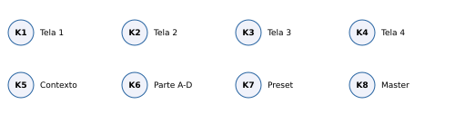
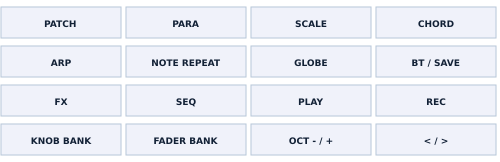
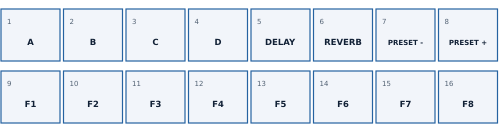
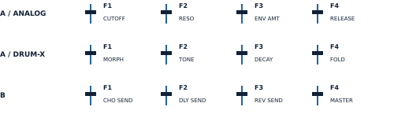
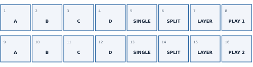
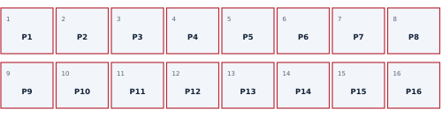
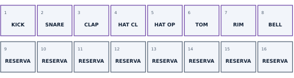
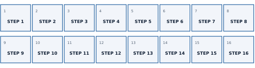
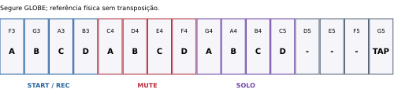

# SMKSYNTH 1.1.0 - Manual completo

[PDF](pdf/SMKSYNTH-1.1.0-Manual-PT.pdf) · [Português](MANUAL.md) · [English](MANUAL.en.md)

Referência: firmware 1.1.0, SMK-37 Pro_19634 / SMK-37 Elite_19634.

## Índice

- 1. Visão geral e navegação
- 2. Botões: referência
- 3. Performance, faders e rodas
- 4. Favoritos e presets
- 5. Split e Layer
- 6. Patterns e cenas
- 7. DRUM-X e Drum Pads
- 8. Gravação ao vivo e passo a passo
- 9. Sequenciador: vistas e controles
- 10. Transposição e comandos segurados
- 11. ANALOG: osciladores, filtro e envelopes
- 12. LFO, arpejador, polifonia e saída
- 13. Efeitos e mixer
- 14. GLOBAL e MIDI
- 15. Salvamento, instalação e backup
- 16. Simulador, problemas e referência
- SUPER / Supersaw
- MIDI OUT - USB e TRS/DIN
- Sustain e MIDI PANIC
- Apêndice MIDI / 1
- Apêndice MIDI / 2
- Apêndice MIDI / 3
- Atualização e áudio USB

## Desenvolvimento com IA

Desenvolvido com IA: Marcus Padrini definiu e orientou a experiência, criou os patterns e testou no instrumento. O ChatGPT (OpenAI) contribuiu com soluções técnicas e gerou e revisou código, ferramentas, documentação e gráficos. Engines originais: autores em CREDITS.md. Sem endosso da OpenAI.

## 1. Visão geral e navegação

Firmware 1.1.0 para M-VAVE SMK-37 Pro / Elite. Quatro partes A-D; ANALOG (OberVave) ou DRUM-X em cada parte. Oito vozes ANALOG compartilhadas. 16 patterns; até 256 steps por track e até quatro notas por step ANALOG.

K1-K4 editam os rótulos mostrados na tela. K6 seleciona a parte, K7 o preset e K8 o master físico. K5 é contextual: tempo na Performance e em páginas comuns, página/barra em STEPS, próximo pattern nas demais vistas SEQ e Mixer, ou LEVEL/OCT no Split/Layer.

Banco de pads e página da tela são estados distintos. PLAY, REC e seleção de engine não escolhem outro banco automaticamente. SEQ solicita explicitamente os steps; KNOB BANK volta ao ciclo manual.

| Banco | Entrada | Finalidade |
| --- | --- | --- |
| 1 | KNOB BANK | Performance e oito favoritos |
| 2 | KNOB BANK | Duas linhas Split/Layer |
| 3 | KNOB BANK | 16 patterns/cenas e save |
| 4 | KNOB BANK + DRUM-X | Tocar/gravar oito instrumentos |
| SEQ | SEQ | 16 steps da página |

Toque = pressione e solte. Segure = mantenha pressionado pelo tempo indicado. Os diagramas de pads usam duas fileiras de oito, da esquerda para a direita: 1-8 em cima, 9-16 embaixo. Os demais desenhos são mapas funcionais, sem escala.

## 2. Botões: referência

| Botão | Função |
| --- | --- |
| PATCH | Toque: Performance; na Performance abre Mixer; no Mixer percorre as sete linhas. Segure 0,7 s: volta à Performance. |
| PARA | Toque: páginas de síntese; em STEPS limpa o step e avança (DRUM: limpa o hit da lane). Segure: edição/erase. |
| CHORD | ANALOG: FILTER ENV / AMP ENV. DRUM-X: DRUM SOUND. |
| NOTE REPEAT | ANALOG: LFO / LFO DEST / LFO +. DRUM-X redireciona para DRUM SOUND. |
| ARP | Abre ARP. Novo toque nessa página alterna HOLD da parte. |
| SCALE | Segure em STEPS ANALOG: STEP+. Na página GLOBAL, toque alterna SYNC AUTO / INTERNAL. |
| GLOBE | Toque: GLOBAL > POLYPHONY > OUTPUT > PART SETUP. Segure: teclas para start/stop, mute, solo e tap tempo. |
| BT / SAVE | Toque: salva o preset da parte no programa atual. Segure 0,7 s: SAVE PRESET AS; K7 escolhe destino, BT confirma. |
| FX | Toque: CHORUS > DELAY > REVERB > DRIVE. Segure: K1/K2/K3 retornos chorus/delay/reverb; K4 tempo do delay. |
| SEQ | Toque: vistas do sequenciador e posse explícita dos pads de steps. Segure: teclas brancas viram steps. |
| PLAY | Inicia do step 1 ou para. Parar também encerra REC. |
| REC | Toque: arma parado; em execução liga/desliga gravação. Segure mais de 1,2 s: apaga a track selecionada. |
| KNOB BANK | Toque: percorre bancos de pads. Segure 0,7 s: Performance/Favoritos. Saindo de SEQ, um toque retorna a Performance. |
| FADER BANK | Alterna banco A / B dos quatro faders; LED aceso indica B. Não muda o banco de pads. |
| OCT - / + | Oitava da parte selecionada: -2 a +2; os dois juntos zeram. Com SEQ segurado: página; com PARA segurado: undo/redo. |
| < / > | Página de 16 steps da track selecionada, dentro do comprimento definido. |

## 3. Performance, faders e rodas

|  | K1 | K2 | K3 | K4 |
| --- | --- | --- | --- | --- |
| ANALOG | CUTOFF | RESO | ENV AMT | RELEASE |
| DRUM-X | MORPH | TONE | DECAY | FOLD |
| KEY TRANS ON | Normal | Normal | Normal | KEY TR |

Pads 1-4 selecionam A-D. Pads 5/6 desligam ou restauram os sends de delay/reverb da parte. Pads 7/8 trocam preset. Quando KEY TRANS está ligado, K4 mostra KEY TR no lugar de Release/Fold; gire à esquerda para desligar a captura.

Fader Bank A controla a parte selecionada em qualquer página. Bank B: F1-F3 são sends por parte. GLOBAL > FADER MODE escolhe JUMP (assume imediatamente) ou CATCH (assume ao cruzar o valor salvo). F4 e K8 controlam o mesmo master físico. Não confunda esse controle com VOL na linha MASTER do Mixer.

Pitch e Mod físicos seguem a parte selecionada. Pitch usa o alcance BEND do timbre; Mod acrescenta vibrato. As notas já pressionadas mantêm seus note-offs corretos ao trocar de parte.

## 4. Favoritos e presets

1. Selecione a parte com K6 ou pad 1-4 e ajuste o som.
2. Para memorizar, segure um dos pads 9-16 por 0,7 s.
3. Pare PLAY/REC, solte notas e sustain e aguarde FAVOURITES SAVED.
4. Para recuperar, toque no favorito. Ele entra na parte selecionada; não muda para a parte de origem.

Cada favorito guarda o snapshot do som, número de programa, marca de edição, oitava do patch e sends chorus/delay/reverb. Os retornos e caudas dos efeitos compartilhados são preservados no recall. Não é necessário salvar o som antes como preset extra.

| Operação | Comando | Resultado |
| --- | --- | --- |
| Salvar preset | BT / SAVE | Sobrescreve o programa atual da parte |
| Salvar preset como | Segure BT; K7; BT | Escolhe e sobrescreve um dos 99 programas |
| Cancelar Save As | PATCH | Fecha sem confirmar a escrita |

Há 64 presets de fábrica e posições 65-99 INIT na base. Um save do usuário pode ocupar qualquer posição como sobreposição. Preset não contém toda a sequência nem as quatro partes. Aguarde PRESET SAVED / SETTINGS SAVED antes de desligar; se estiver tocando, a escrita aguarda parada e silêncio.

## 5. Split e Layer

As duas fileiras são configurações independentes. A-D selecionam partes ANALOG. Segure uma parte e pressione outra na mesma fileira para formar o par/layer. SINGLE usa o fluxo normal da parte selecionada; SPLIT divide o teclado; LAYER toca as duas partes. DRUM-X não entra nessas combinações.

|  | K1 | K2 | K3 | K4 |
| --- | --- | --- | --- | --- |
| LEVEL | MODE | Nível parte 1 | Nível parte 2 | SPLIT |
| OCT | MODE | Oitava parte 1 | Oitava parte 2 | SPLIT |

1. Entre no banco 2 com KNOB BANK.
2. Na fileira desejada, forme o par com dois pads A-D.
3. Toque SPLIT ou LAYER; ajuste o ponto de divisão em K4.
4. K5 alterna os controles K2/K3 entre níveis (0-100%) e oitavas (-2 a +2).
5. Toque PLAY 1 (pad 8) ou PLAY 2 (pad 16) para tocar essa configuração.
6. Salve o pattern para guardar as duas linhas e a linha ativa.

Pad 8/16 branco forte indica a linha tocada. Editar a outra linha não a ativa. K6 continua escolhendo a parte gravada; para gravar, essa parte deve fazer parte do roteamento ouvido. Em SPLIT, notas abaixo do ponto pertencem à primeira parte; no ponto e acima, à segunda.

## 6. Patterns e cenas

Cada posição reúne a sequência de quatro tracks e sua cena: quatro sons, mix e configurações Split/Layer. Favoritos são um banco separado. O tempo é global, não um BPM independente por pattern.

| Gesto | Ação |
| --- | --- |
| Toque em P1-P16 | Carrega parado; tocando, agenda para o próximo compasso |
| Segure 0,7 s | Salva o pattern atual nessa posição; outra posição funciona como cópia |
| Posição já ocupada | OVERWRITE: toque no mesmo pad em até 4 s para confirmar |
| Outro pad / PATCH / tempo esgotado | Cancela confirmação de sobrescrita |

A escrita aguarda parada e silêncio. Se aparecer STOP TO FINISH SAVE FIRST, finalize a gravação anterior antes de trocar/copiar. Não há salvamento automático das edições ao navegar; salve antes de carregar outro pattern.

| Luz | Significado |
| --- | --- |
| Vermelho muito fraco | Posição vazia |
| Vermelho | Posição ocupada |
| Azul | Pattern selecionado; intensidade varia se editado |
| Azul piscando | Troca agendada |
| Vermelho piscando | Confirmação de sobrescrita |
| Branco claro | Gravação pendente nessa posição |

Conteúdo inicial: P1-P5 preenchidos; P6-P16 livres; oito favoritos; 90 BPM; nenhum preset pessoal extra. Restaurar seu backup substitui esse conteúdo pelos dados do arquivo.

## 7. DRUM-X e Drum Pads

1. Selecione a parte com K6. Toque GLOBE até PART SETUP.
2. K1 escolhe DRUM-X; K2 escolhe 808 BOOM, 909 CLUB, 606 MINI, 707 SNAP ou DRUM-X.
3. Percorra KNOB BANK até Drum Pads. Selecionar o kit sozinho não muda o banco.
4. Toque os pads superiores com velocity. PLAY/REC preservam o banco escolhido.
5. Para gravar ao vivo, inicie PLAY, toque REC e execute os pads; REC encerra a gravação, PLAY para tudo.

Drum Pads só entra no ciclo com uma parte DRUM-X selecionada. Se trocar para ANALOG com esse banco ativo, ele permanece selecionado e inativo; use K6 para voltar a uma parte DRUM-X ou KNOB BANK para sair. Pads 9-16 são reservados/apagados.

Violeta a cerca de 70% em repouso; branco nos hits ao vivo e nas notas tocadas pela sequência. Cada instrumento pode ser reacionado; hi-hat aberto/fechado se interrompem mutuamente. Os kits 606/707 são pontos de partida tímbricos, não reprodução de ROMs.

|  | K1 | K2 | K3 | K4 |
| --- | --- | --- | --- | --- |
| PERFORM | MORPH | TONE | DECAY | FOLD |
| DRUM SOUND | SOUND | LEVEL | DECAY | PITCH |
| PART SETUP | ENGINE | KIT | VOLUME | TUNE |

| Instrumento | KICK | SNARE | CLAP | HAT CL | HAT OP | TOM | RIM | BELL |
| --- | --- | --- | --- | --- | --- | --- | --- | --- |
| MIDI | 36 | 38 | 39 | 42 | 46 | 45 | 37 | 56 |

Notas MIDI 60-67 também acionam as oito lanes em ordem. No DRUM SEQ, vários hits podem ocupar o mesmo step; velocity, ratchet, chance e nudge pertencem ao step e afetam seus hits.

## 8. Gravação ao vivo e passo a passo

| Modo | Preparação | Gravar / parar |
| --- | --- | --- |
| Ao vivo | PLAY > REC | Toque teclas/pads; REC encerra, PLAY para |
| Armar parado | REC | Primeira nota inicia a gravação; REC + PLAY pode usar count-in |
| Passo a passo ANALOG | PLAY parado; REC apagado; SEQ > STEPS | Toque nota/acorde; solte todas as teclas para avançar |
| Grade DRUM-X | SEQ > DRUM; REC apagado | K1 escolhe lane; pads alternam hits dos 16 steps |

K6 escolhe a track gravada. Comprimento 0 desliga a track; em TRACKS use K3 para dar comprimento (início em 16). O quantize de gravação é individual por parte: TRACKS K4 = OFF, 1/32, 1/16, 1/8 ou 1/4. A gravação ao vivo pode conservar microtiming; o passo a passo zera o nudge do step regravado.

1. Para criar um exemplo ANALOG, escolha uma posição livre e a parte A.
2. Abra SEQ > TRACKS e coloque LENGTH em 16.
3. Vá a STEPS, com REC desligado. Toque um acorde, solte; repita.
4. Uma pausa: deixe o step vazio e avance com K1. PARA limpa o step.
5. Para nota longa, segure as teclas e avance K1 para ligar ao step seguinte.
6. PLAY para ouvir. Pare, entre em Patterns e segure a posição para salvar.

As oitavas físicas por patch e as oitavas Split/Layer são consideradas na gravação. Em Split/Layer, só são gravadas as notas roteadas à parte selecionada por K6. Se ARP estiver ligado, a gravação captura a saída do arpejador em vez do acorde de entrada.

Automação: com PLAY e REC ativos e a track ligada, girar um knob de parâmetro elegível grava seu valor no step tocado. São até quatro parâmetros por track. Parâmetros compartilhados de efeitos, faders e navegação não são gravados por esse caminho. As automações acompanham o pattern; segurar REC para limpar a track apaga também suas automações.

Para apagar a track inteira, selecione-a com K6 e segure REC por mais de 1,2 s. Esse comando não pede segunda confirmação. PARA + OCT- desfaz e PARA + OCT+ refaz a edição disponível (um nível).

## 9. Sequenciador: vistas e controles

|  | K1 | K2 | K3 | K4 |
| --- | --- | --- | --- | --- |
| TRACKS | CUTOFF / MORPH | LEVEL | LENGTH | QUANT |
| STEPS | STEP | NOTE | GATE | VELO |
| STEP+ | STEP | RATCHET | CHANCE | ON/OFF |
| TRACK | LENGTH | DIV | SWING | TRANSP |
| PATTERNS | SLOT | - | GO: gire + | Use pads |
| TRANSPOSE | KEYS | VALUE | RESET | ANALOG: indicação |
| DRUM | SOUND | STEP | VELO | RATCHET |
| DRUM+ | SOUND | CHANCE | NUDGE | ON/OFF |

Toques em SEQ percorrem as vistas. ANALOG: TRACKS > STEPS > TRACK > PATTERNS > TRANSPOSE. STEP+ é acessado segurando SCALE em STEPS. DRUM-X: DRUM > DRUM+ > TRACK > TRACKS > PATTERNS > TRANSPOSE.

Em STEPS/DRUM, K5 avança/recua 16 steps; setas < > mudam a página de pads. Nas outras vistas SEQ, K5 escolhe pattern. K6 sempre seleciona a parte; K7 troca seu preset; K8 master. Uma track comporta até 256 steps em 16 páginas; sua DIV é independente. SWING vai de 50 a 75%; TRANSP por track de -24 a +24 semitons.

RATCHET: 1x-4x; CHANCE: 0-100% em passos de 5%; ON/OFF desativa sem apagar notas. GATE chega a TIE. NOTE desloca o acorde do step. Na grade DRUM, K1 escolhe a lane e cada pad alterna um hit nessa lane; não é o banco Drum Pads.

## 10. Transposição e comandos segurados

|  | K1 | K2 | K3 | K4 |
| --- | --- | --- | --- | --- |
| SEQ TRANSPOSE | Captura ON/OFF | Offset -48..+79 | Zera offset | ANALOG |
| SEQ segurado | Nota de entrada | DIV | SWING | LENGTH |
| Step segurado | NOTE | LEVEL | RATCHET | GATE |
| PARA segurado | SHIFT | Comprimento x2 / metade | TRANSPOSE | - |
| FX segurado | CHO MIX | DLY MIX | REV MIX | DLY TIME |

Em SEQ > TRANSPOSE, K1 liga a captura das teclas. O deslocamento afeta as sequências ANALOG, não o mapa fixo de bateria. Continua ativo ao sair da tela ou mudar de banco de pads. K4 KEY TR na Performance desliga a captura; o deslocamento atual permanece até K3 RESET na tela TRANSPOSE.

SEQ segurado, com REC desligado: 16 teclas brancas F3-G5 controlam steps; pretas F#3-A#4 escolhem as primeiras oito páginas. OCT-/+ também muda páginas. Um step vazio recebe a última nota/acorde; tocar e soltar um step preenchido o apaga. Segure para editar pelos knobs; segure um step e toque outro posterior para criar uma nota longa.

PARA segurado: teclas apagam essa nota dos steps da track. K1 desloca a sequência circularmente; K2 duplica/metade do comprimento; K3 transpõe notas ANALOG. Em DRUM-X, K3 informa DRUM MAP FIXED. OCT- desfaz e OCT+ refaz.

Segure SEQ/PARA/GLOBE/FX e toque PATCH para travar o comando sem continuar segurando. Toque no próprio botão para destravar. Não confunda essa camada temporária de comandos com o modo LAYER de duas partes.

Com GLOBE segurado: F3/G3/A3/B3 iniciam/param tracks A-D no compasso (com REC ativo, selecionam a gravação); C4/D4/E4/F4 alternam mute; G4/A4/B4/C5 alternam solo; G5 é tap tempo. Os pads mantêm o banco escolhido.

## 11. ANALOG: osciladores, filtro e envelopes

PARA percorre OSC 1, OSC 2, OSC MOD, FILTER, FILTER + e SUPER. CHORD alterna FILTER ENV e AMP ENV. Os quatro knobs seguem as colunas abaixo; os pads conservam o banco manual e os faders conservam Bank A/B.

|  | K1 | K2 | K3 | K4 |
| --- | --- | --- | --- | --- |
| OSC 1 | WAVE | PW | LEVEL | NOISE |
| OSC 2 | WAVE | PW | LEVEL | SEMI |
| OSC MOD | SYNC | X-MOD | ENV>O2 | FINE |
| FILTER | RESO | ENV AMT | KEY TRK | TYPE |
| SUPER | DET1 | MIX1 | DET2 | MIX2 |
| FILTER + | DRIVE | VEL>FLT | VEL>AMP | MORPH |
| FILTER ENV | ATTACK | DECAY | SUSTAIN | RELEASE |
| AMP ENV | ATTACK | DECAY | SUSTAIN | RELEASE |

| Grupo | Uso |
| --- | --- |
| OSC 1/2 | WAVE: OFF, SAW, PULSE, SAW+PLS ou SUPER; PW controla largura de pulso ou DETUNE em SUPER. LEVEL mistura cada oscilador; NOISE acrescenta ruído. SEMI afina OSC2 em -24 a +24 semitons; FINE é ajuste fino. |
| OSC MOD | SYNC sincroniza osciladores; X-MOD controla modulação cruzada; ENV>O2 aplica envelope à afinação do OSC2 (bipolar). |
| FILTER | CUTOFF está na Performance/fader A1; RESO realça a frequência de corte. ENV AMT é bipolar. KEY TRK segue a altura. TYPE: LP12, HP12, BP12, NOTCH, LP24, SEM; MORPH modifica SEM. |
| ENVELOPES | ATTACK: entrada; DECAY: queda até SUSTAIN; RELEASE: saída após soltar. FILTER ENV atua no filtro; AMP ENV na amplitude. VEL>FLT/VEL>AMP definem a resposta à velocity. |

Parâmetros não listados com unidade física usam a escala interna 0-127. Os tempos e frequências exibidos na tela são conversões do firmware; um mesmo incremento bruto não corresponde sempre ao mesmo incremento em ms/Hz.

## 12. LFO, arpejador, polifonia e saída

|  | K1 | K2 | K3 | K4 |
| --- | --- | --- | --- | --- |
| LFO | SHAPE | RATE | DELAY | PHASE |
| LFO DEST | PITCH | PWM | FILTER | AMP |
| LFO + | PITCH> | PWM> | - | - |
| ARP | ARP | DIV | OCTAVES | GATE |
| POLYPHONY | MODE | VOICES | DETUNE | GLIDE |
| OUTPUT | VINTAGE | SPREAD | BEND | VOLUME |
| PART SETUP | ENGINE | KIT | MODE | GLIDE |

NOTE REPEAT percorre LFO / LFO DEST / LFO +. SHAPE: TRI, SAW, RAMP, SQUARE, S&H, RANDOM. PHASE: SYNC, FREE, SPREAD. PITCH/PWM escolhem OSC1, OSC2 ou BOTH. As profundidades de PITCH, PWM, FILTER e AMP são independentes.

ARP abre a página. Modos OFF, UP, DOWN, UP/DN, RANDOM e PLAYED. DIV: 1/4, 1/8, 1/8T, 1/16, 1/16T, 1/32, 1/32T. OCTAVES vai de 0 a 4 na escala do firmware. GATE controla duração. Novo toque em ARP alterna HOLD da parte, mantendo as notas após soltar. Desligue HOLD/ARP para terminar.

GLOBE percorre GLOBAL, POLYPHONY, OUTPUT e PART SETUP. ANALOG: MODE seleciona POLY, DUAL, UNISON ou MONO. VOICES e DETUNE configuram unison; GLIDE controla portamento. As oito vozes ANALOG são compartilhadas entre partes; unison consome mais vozes por nota.

OUTPUT ANALOG: VINTAGE adiciona variação, SPREAD distribuição estéreo, BEND alcance de pitch em semitons (0-24), VOLUME nível do patch. PART SETUP: K1 escolhe engine; K2 só escolhe KIT em DRUM-X. Em DRUM-X, POLYPHONY vira macros MORPH/TONE/DECAY/FOLD; OUTPUT usa K1 VOLUME e K2 TUNE, sem K3/K4.

## 13. Efeitos e mixer

|  | K1 | K2 | K3 | K4 |
| --- | --- | --- | --- | --- |
| CHORUS | RATE | DEPTH | MIX | - |
| DELAY | TIME | FEEDBK | TONE | MIX |
| REVERB | SIZE | DAMP | PRE-DLY | MIX |
| DRIVE | TYPE | DRIVE | TONE | MIX |
| Mixer: LEVEL/PAN/SEND | A | B | C | D |
| Mixer: MASTER | VOL | DJ FLT | DRIVE | COMP |

FX percorre as quatro páginas de efeito. Os efeitos são compartilhados: MIX define o retorno global; o send define quanto cada parte alimenta o efeito. Para variar a quantidade em uma parte, use Bank B F1/F2/F3 ou a linha SEND do Mixer. Um retorno MIX em zero pode tornar o efeito inaudível mesmo com send alto.

DELAY TIME usa divisões sincronizadas: 1/16, 1/8T, 1/8, 1/8 pontuada, 1/4, 1/4 pontuada e 1/2. FEEDBK controla repetições; TONE escurece/clareia. REVERB: SIZE tamanho, DAMP amortecimento, PRE-DLY atraso inicial. CHORUS: RATE velocidade, DEPTH intensidade.

Da Performance, toque PATCH para abrir Mixer. Toques seguintes percorrem LEVEL > PAN > SEND CHORUS > SEND DELAY > SEND REVERB > SEND DRIVE > MASTER. K1-K4 ajustam A-D nas seis primeiras linhas. Em MASTER, VOL/DJ FLT/DRIVE/COMP são controles globais do mixer. K5 seleciona pattern; segure PATCH para sair.

Mute e solo por parte: GLOBE segurado mais as teclas correspondentes. Os estados são indicados no Mixer. F4 Bank B e K8 são o volume físico de saída; não são quatro volumes individuais.

## 14. GLOBAL e MIDI

|  | K1 | K2 | K3 | K4 |
| --- | --- | --- | --- | --- |
| GLOBAL | TEMPO | CLICK | MIDI CH | TUNE |

TEMPO: 40-240 BPM. CLICK: OFF, REC, ON ou COUNT-IN. Em COUNT-IN, arme REC parado e use PLAY para a contagem. MIDI CH: OMNI ou canal base 1-13. TUNE: -50 a +50 cents. Na página GLOBAL, SCALE alterna SYNC AUTO / INTERNAL.

| Mensagem | Comportamento |
| --- | --- |
| Notas / velocity | Canal base roteia para A; três canais seguintes para B-D. Em OMNI, usa a parte selecionada. Para quatro canais completos, escolha base 1-13. |
| Program Change | 0-98 escolhem os programas 1-99. Em OMNI afeta a parte selecionada; em canais definidos, a parte desse canal. |
| CC 7 / CC 64 | Volume MIDI / sustain (64 ou mais = pedal ligado). |
| CC 120 / 123 | Panic / desligar notas. |
| Pitch Bend / CC 1 | Pitch MIDI e profundidade de modulação; controles físicos têm roteamento da parte selecionada. |
| Clock / Start / Continue / Stop | AUTO aceita relógio e transporte MIDI recebido; INTERNAL ignora essas mensagens. |

As notas MIDI recebidas são absolutas: não aplique a elas a oitava física do SMK como se fossem teclas locais. A saída MIDI USB/TRS transmite as quatro partes: A usa o canal-base; B-D os seguintes. OMNI transmite em 1-4. Teclas, pads, Split/Layer, ARP e sequenciadores enviam notas com suas oitavas e transposições. Não há MIDI Clock/Start/Stop de saída.

O apêndice lista os CCs dos parâmetros ANALOG. Em DRUM-X, vários endereços internos são reutilizados para macros/lanes; use a interface DRUM para editar e o mapa de notas da seção 7 para acionar bateria.

## 15. Salvamento, instalação e backup

| O que guardar | Comando | Conteúdo |
| --- | --- | --- |
| Preset | BT / SAVE | Um som/programa; não a sequência de quatro partes |
| Favorito | Segure pad F1-F8 | Snapshot da parte e sends |
| Pattern/cena | Segure P1-P16 | Sequências, sons, mix, duas linhas Split/Layer |
| Backup completo | Ferramenta web | Banco salvo: presets, favoritos, patterns/cenas e globals |

Salvamento manual: uma edição na tela não é uma escrita em flash. Pare o transporte, solte notas/sustain e aguarde a mensagem de conclusão. Pattern e preset pendentes bloqueiam outras operações que conflitem. Exporte somente depois de salvar no instrumento.

1. Para primeira instalação, parta do firmware oficial M-VAVE V016 do seu modelo Pro ou Elite. Use o M-UPGRADE oficial para retornar a essa versão.
2. Exporte seu .smksynth antes de retornar ao oficial. A primeira instalação inicializa/substitui o banco.
3. Use Chrome/Edge no computador, HTTPS, cabo USB de dados e alimentação estável. Feche outros aplicativos MIDI.
4. No instalador web, conecte, confira origem/destino e confirme. Aguarde SMK-37 Pro_19634 / SMK-37 Elite_19634.
5. Se interromper, retome no mesmo navegador/site com o mesmo pacote. Não troque de instalador no meio.

Backup: pare PLAY/REC, solte controles/notas e conecte a ferramenta. Exporte o banco atual nesta sessão antes de restaurar. Escolha o arquivo, revise e digite RESTAURAR (também na interface inglesa). Restauração substitui o banco inteiro; não mescla. Ao concluir, reinicie e confira seus sons.

RESTORE PENDING: retome obrigatoriamente o mesmo arquivo; o instrumento fica bloqueado até concluir. Firmware oficial não importa .smksynth. Após reinstalar SMKSYNTH, restaure seu banco pelo navegador. A instalação física foi confirmada por Marcus no instrumento; os logs automatizados documentam os demais testes.

## 16. Simulador, problemas e referência

O simulador executa o código de áudio/interface em WebAssembly. Clique em Iniciar; no endereço HTTPS, o áudio é ativado por esse gesto. Use mouse/toque, arraste knobs verticalmente e ajuste velocity. As teclas A W S E D F T G Y H U J K O L P ; tocam notas.

Sua memória é local ao navegador/domínio. SAVE no painel grava nessa memória. Exportar sessão guarda um arquivo JSON do simulador; Importar sessão substitui essa memória. Não use esse JSON como backup físico .smksynth. Reiniciar não é apagar a sessão; Rever boot reexecuta a inicialização.

| Sintoma | Verifique |
| --- | --- |
| Sem som | K8/master, nível da parte/Mixer, mute/solo, engine e roteamento Split. No simulador, Iniciar, áudio do navegador e Silenciar. |
| Pads não tocam bateria | Selecione parte DRUM-X e depois banco Drum Pads com KNOB BANK. Escolher kit não muda o banco. |
| Fader de send não responde | Bank B e parte correta; cruze o valor salvo para pickup. Confira retorno MIX do efeito. |
| Teclas só transpõem | KEY TRANS ativo; desligue em SEQ > TRANSPOSE K1 ou Performance K4 KEY TR. Zere offset com K3 RESET se necessário. |
| Não grava notas | LENGTH maior que zero, K6 na parte correta, roteamento Split e REC/step entry corretos. |
| Save não termina | Pare PLAY/REC, solte notas/sustain e aguarde silêncio. Não desligue durante a escrita. |
| Exportação com sessão expirada | Pare tudo, aguarde saves, reinicie e reconecte antes de nova exportação. Não conte arquivo incompleto como backup válido. |
| Instalador recusa firmware | Primeira instalação exige V016 do modelo conectado (Pro ou Elite); outras origens são bloqueadas. |

Projeto independente. Síntese ANALOG: OberVave/zvenson; DRUM-X: JIANT; SUPER: originada do Clipper/3dSam (github.com/isod89/clipper-fm1); direção e testes SMKSYNTH: Marcus Padrini; soluções técnicas, código das adaptações e documentação com ChatGPT (OpenAI), sob sua orientação. Consulte CREDITS.md e LICENSING.md no repositório para todas as atribuições. GPL-3.0-only.

## SUPER / Supersaw

Selecione WAVE = SUPER em OSC 1 e/ou OSC 2. Cada oscilador mistura sete serras: uma central e seis desafinadas. PW passa a mostrar DETUNE. LEVEL continua ajustando o volume do oscilador.

PARA percorre OSC 1 > OSC 2 > OSC MOD > FILTER > FILTER + > SUPER. Na página SUPER, os quatro knobs controlam:

| K1 | K2 | K3 | K4 |
| --- | --- | --- | --- |
| DET1 | MIX1 | DET2 | MIX2 |

DET1/DET2 (0-127): abertura da desafinação de cada oscilador. MIX1/MIX2 (0-127): presença das seis serras laterais em relação à central; MIX 0 mantém somente a serra central. O padrão é MIX 64.

Comece com um OSC SUPER, DETUNE moderado e MIX 64. Acrescente OSC2 e efeitos conforme o timbre. SEMI/FINE do OSC2, pitch bend, glide, vibrato, envelopes e filtros continuam disponíveis. São oito vozes ANALOG compartilhadas; as sete serras não acrescentam polifonia. UNISON empilha vozes completas e aumenta o consumo.

Quando qualquer OSC usa SUPER, SYNC e X-MOD são ignorados. PWM não modula a desafinação SUPER. DETUNE usa os mesmos CCs e a automação de PW; MIX não tem CC ou automação dedicados.

Os ajustes são salvos em presets, favoritos, cenas e backups. Sons antigos abrem sem conversão, com MIX 64. Antes de retornar a um firmware anterior à SUPER, restaure um backup feito naquela versão: ela não entende WAVE 4 nem todos os novos favoritos.

P mostra o pico de processamento em microssegundos; O conta blocos que excederam o prazo. Ambos reiniciam no boot. A implementação SS3 foi aprovada no instrumento por Marcus; o consumo depende da polifonia, do unison e dos efeitos.

Origem: Clipper, de 3dSam, sobre Felucca, com curva e offsets de desafinação derivados da análise de Adam Szabo citada pelo Clipper. Fonte: https://github.com/isod89/clipper-fm1 . O SMKSYNTH adapta essa base com MIX independente e otimizações próprias; não é uma reprodução exata do Roland JP-8000/JP-8080. GPL-3.0-only; atribuições em CREDITS.md e LICENSING.md.

## MIDI OUT - USB e TRS/DIN

A saída MIDI transmite as quatro partes, independentemente da parte selecionada no painel. GLOBAL > MIDI CH define o canal-base de A (1-13). B, C e D usam base +1, +2 e +3. OMNI na recepção corresponde a canais de saída 1-4.

| Parte | Canal de saída | Exemplo: base 3 |
| --- | --- | --- |
| A / 1 | BASE | 3 |
| B / 2 | BASE + 1 | 4 |
| C / 3 | BASE + 2 | 5 |
| D / 4 | BASE + 3 | 6 |

USB e TRS recebem as mesmas mensagens musicais. Teclas, pads, Split/Layer, arpejos e sequenciadores transmitem notas. DRUM-X usa o canal da sua parte, sem canal 10 obrigatório. Split/Layer transmite as notas reais de cada parte, com suas oitavas. Cada Note Off conserva o destino do Note On original.

Conecte MIDI OUT de 3,5 mm ao MIDI IN do destino com o adaptador TRS-DIN adequado ao teclado. A saída de áudio é outro conector. TRS funciona com bateria e sem computador; USB requer host MIDI.

Pitch Bend é enviado em 14 bits (centro 8192); mod wheel usa CC1 (0-127). Ambos acompanham somente a parte selecionada, inclusive em Split/Layer, como a engine local. Trocar a parte neutraliza o canal anterior. O estado das rodas é reenviado após Panic.

Não há transmissão de MIDI Clock/Start/Stop nem envio automático de Program Change ao trocar um preset interno. Notas MIDI recebidas não fazem Thru simples; os arpejos gerados podem transmitir. A recepção de bend é global no canal-base, herdada da engine; isto é diferente do envio por parte.

## Sustain e MIDI PANIC

### Pedal de sustain

1. Conecte o pedal antes de ligar e mantenha-o solto durante a inicialização.
2. A polaridade de um pedal de chave é detectada ao ligar. Não há meio pedal; reinicie após trocar o pedal.
3. Pressione o pedal, toque e solte um acorde: ele continua até soltar o pedal. O sustain atende as quatro partes melódicas, inclusive Split/Layer e ARP. DRUM-X mantém seu disparo único interno.
4. CC64 é enviado aos canais das quatro partes e às notas ainda mantidas em canais anteriores. Ao soltar, esses canais recebem pedal off. O sustain físico e o recebido por MIDI têm controle independente.

### Panic: GLOBE + PLAY

Pressione GLOBE e PLAY juntos, em qualquer ordem. O comando para PLAY/REC, desliga HOLD/sustain, limpa notas pendentes e corta as vozes internas. USB e TRS enviam CC64=0, CC123=0 e CC120=0 aos 16 canais. Solte o pedal antes de usar sustain novamente. As caudas dos efeitos podem terminar normalmente.

A 1.1.0 também corrige vozes presas ao mudar POLY/DUAL para MONO/UNISON com teclas mantidas. O Note Off já chegava, mas vozes do modo anterior podiam não ser liberadas. Glide não foi alterado; o caso de mudar somente Glide não reproduziu a falha nos testes.

## Apêndice MIDI / 1

Valores CC recebidos são 0-127 e escalados ao máximo do parâmetro. A tabela se refere à engine ANALOG. Identificadores preservam nomes do código para evitar ambiguidades entre os dois osciladores/envelopes.

| ID | CC | Tela | Máximo bruto |
| --- | --- | --- | --- |
| O1_WAVE | 20 | WAVE | NWAVE - 1 |
| O1_PW | 21 | PW | 127 |
| O1_LVL | 22 | LEVEL | 127 |
| NOISE | 23 | NOISE | 127 |
| O2_WAVE | 24 | WAVE | NWAVE - 1 |
| O2_PW | 25 | PW | 127 |
| O2_LVL | 26 | LEVEL | 127 |
| O2_SEMI | 27 | SEMI | 48 |
| SYNC | 28 | SYNC | 1 |
| XMOD | 29 | X-MOD | 127 |
| ENV_O2 | 30 | ENV>O2 | 127 |
| O2_FINE | 31 | FINE | 127 |
| CUTOFF | 74 | CUTOFF | 127 |
| RESO | 71 | RESO | 127 |
| FENV_AMT | 32 | ENV AMT | 127 |
| KEYTRK | 33 | KEY TRK | 127 |
| FTYPE | 34 | TYPE | NFTYPE - 1 |
| DRIVE | 35 | DRIVE | 127 |
| VEL_FLT | 36 | VEL>FLT | 127 |
| VEL_AMP | 37 | VEL>AMP | 127 |
| FA | 38 | ATTACK | 127 |
| FD | 39 | DECAY | 127 |
| FS | 40 | SUSTAIN | 127 |
| FR | 41 | RELEASE | 127 |

Constantes: NFTYPE-1 = 5; NDDIV-1 = 6. WAVE 0-4; MODE 0-3; SHAPE 0-5. Para cada página e seus quatro knobs, consulte seções 11-14. CCs de efeitos são compartilhados; não são os sends individuais do Bank B.

## Apêndice MIDI / 2

Valores CC recebidos são 0-127 e escalados ao máximo do parâmetro. A tabela se refere à engine ANALOG. Identificadores preservam nomes do código para evitar ambiguidades entre os dois osciladores/envelopes.

| ID | CC | Tela | Máximo bruto |
| --- | --- | --- | --- |
| AA | 73 | ATTACK | 127 |
| AD | 42 | DECAY | 127 |
| AS | 43 | SUSTAIN | 127 |
| AR | 72 | RELEASE | 127 |
| LFO_SHAPE | 44 | SHAPE | 5 |
| LFO_RATE | 45 | RATE | 127 |
| LFO_DELAY | 46 | DELAY | 127 |
| LFO_PHASE | 47 | PHASE | 2 |
| LFO_PITCH | 48 | PITCH | 127 |
| LFO_PWM | 49 | PWM | 127 |
| LFO_FLT | 50 | FILTER | 127 |
| LFO_AMP | 51 | AMP | 127 |
| LFO_PITCH_TO | 52 | PITCH> | 2 |
| LFO_PWM_TO | 53 | PWM> | 2 |
| MODE | 54 | MODE | 3 |
| UNI_N | 55 | VOICES | 8 |
| UNI_DET | 56 | DETUNE | 127 |
| GLIDE | 5 | GLIDE | 127 |
| VINTAGE | 57 | VINTAGE | 127 |
| SPREAD | 58 | SPREAD | 127 |
| BEND | 59 | BEND | 24 |
| VOLUME | 60 | VOLUME | 127 |
| MOD_DEPTH | 1 | MOD DPT | 127 |
| ARP_MODE | 61 | ARP | 5 |

Constantes: NFTYPE-1 = 5; NDDIV-1 = 6. WAVE 0-4; MODE 0-3; SHAPE 0-5. Para cada página e seus quatro knobs, consulte seções 11-14. CCs de efeitos são compartilhados; não são os sends individuais do Bank B.

## Apêndice MIDI / 3

Valores CC recebidos são 0-127 e escalados ao máximo do parâmetro. A tabela se refere à engine ANALOG. Identificadores preservam nomes do código para evitar ambiguidades entre os dois osciladores/envelopes.

| ID | CC | Tela | Máximo bruto |
| --- | --- | --- | --- |
| ARP_DIV | 62 | DIV | 6 |
| ARP_OCT | 63 | OCTAVES | 4 |
| ARP_GATE | 65 | GATE | 127 |
| FMORPH | 66 | MORPH | 127 |
| CHO_RATE | 67 | RATE | 127 |
| CHO_DEPTH | 68 | DEPTH | 127 |
| CHO_MIX | 69 | MIX | 127 |
| DLY_TIME | 70 | TIME | NDDIV - 1 |
| DLY_FB | 75 | FEEDBK | 127 |
| DLY_TONE | 76 | TONE | 127 |
| DLY_MIX | 77 | MIX | 127 |
| REV_SIZE | 78 | SIZE | 127 |
| REV_DAMP | 79 | DAMP | 127 |
| REV_PRE | 80 | PRE-DLY | 127 |
| REV_MIX | 81 | MIX | 127 |

Constantes: NFTYPE-1 = 5; NDDIV-1 = 6. WAVE 0-4; MODE 0-3; SHAPE 0-5. Para cada página e seus quatro knobs, consulte seções 11-14. CCs de efeitos são compartilhados; não são os sends individuais do Bank B.

## Atualização e áudio USB

Já usa SMKSYNTH? Exporte um backup e escolha Atualizar no instalador público. As versões públicas, MIDI M1-M1.2 e testes compatíveis são aceitos e o banco salvo é preservado. Instalar é exclusivo para a primeira instalação a partir da V016 e substitui o banco. A identidade pública continua SMK-37 Pro_19634 / SMK-37 Elite_19634.

Áudio USB estéreo de 16 bits, 44,1/48 kHz: testado no Mac e no iPhone com AudioShare. Problema conhecido: vídeos gravados no iPhone com áudio USB podem conter cliques ou cortes.

## Links

- [Site](https://4t59m4f784-creator.github.io/SMKSYNTH/)
- [Instalador](https://4t59m4f784-creator.github.io/SMKSYNTH/install/)
- [Simulador](https://4t59m4f784-creator.github.io/SMKSYNTH/simulator/)
- [Backup](https://4t59m4f784-creator.github.io/SMKSYNTH/backup/)

[GitHub](https://github.com/4t59m4f784-creator/SMKSYNTH)
