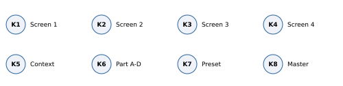
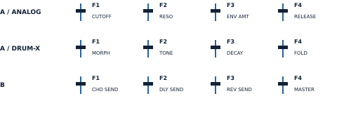
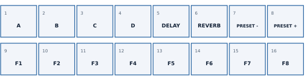
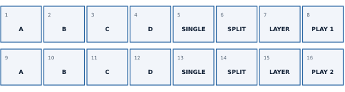
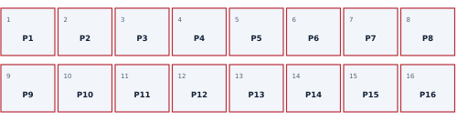
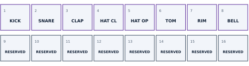

# SMKSYNTH 1.1.0 - Quick start guide

[PDF](pdf/SMKSYNTH-1.1.0-Quick-Start-EN.pdf) · [Português](QUICKSTART.md) · [English](QUICKSTART.en.md)

Reference: firmware 1.1.0, SMK-37 Pro_19634 / SMK-37 Elite_19634.

## Contents

- Quick start / 1. First steps
- Quick start / 2. Favourites and Split/Layer
- Quick start / 3. Patterns and drums
- Quick start / 4. Record, save and restore
- MIDI OUT - USB and TRS/DIN
- Sustain and MIDI PANIC

## AI-assisted development

Developed using AI: Marcus Padrini defined and directed the experience, created the patterns and tested on hardware. ChatGPT (OpenAI) contributed technical solutions and generated and revised code, tools, documentation and graphics. Original engines: authors in CREDITS.md. No OpenAI endorsement.

## Quick start / 1. First steps

SMKSYNTH 1.1.0 - M-VAVE SMK-37 Pro / Elite. Use this guide after installation. First installation requires official V016 and replaces the bank. Save and export your work before returning to official firmware.

1. Set K8/master to a suitable level and press PLAY.
2. K6 selects A-D; K7 changes the part preset.
3. KNOB BANK cycles Performance > Split/Layer > Patterns; Drum Pads is added when the selected part is DRUM-X.
4. In Patterns, tap P1-P5 for examples. P6-P16 are empty.
5. PLAY stops. Hold KNOB BANK 0.7 s to return to Performance/Favourites.

K1-K4 follow the screen. K5: tempo on Performance; LEVEL/OCT in Split/Layer; page in STEPS; pattern in other SEQ/Mixer views. FADER BANK only changes faders. GLOBAL > FADER MODE: JUMP engages immediately; CATCH waits to cross the stored value. Bank B F4 = K8/master.

Five examples start at 90 BPM. Eight favourites, no extra personal presets. PLAY/REC and engine choice preserve the pad bank; SEQ explicitly requests steps.

## Quick start / 2. Favourites and Split/Layer

### Bank 1 - Performance/Favourites

1-4: part A-D. 5/6: delay/reverb send on/off. 7/8: previous/next preset. 9-16: eight favourites. Tap to recall into the selected part; hold 0.7 s to capture. Stop and release notes/sustain; wait for FAVOURITES SAVED.

### Bank 2 - Split/Layer

1. In the same row, hold one A-D part and tap another to form the pair. Use two ANALOG parts.
2. Choose SINGLE, SPLIT or LAYER. K4 sets the split point.
3. K5 switches K2/K3 between the two parts’ levels and octaves.
4. Pad 8 or 16 selects the playing row (bright white). Editing the other row does not activate it.
5. Save the pattern to store both configurations and the active row.

K6 selects the recording part. BT saves a preset; it does not replace pattern/scene saving.

## Quick start / 3. Patterns and drums

### Bank 3 - Patterns/Scenes

Tap to load. During PLAY, the change is scheduled for the next bar. Hold 0.7 s to save the current pattern to that slot. If occupied, tap the same pad within 4 s to confirm OVERWRITE; another pad/PATCH cancels. Stop and wait for writing to complete.

Red: occupied; very dim red: empty; blue: selected; blinking blue: next; blinking red: confirm. A pattern stores sequence, four sounds, mix and Split/Layer. Changing patterns does not automatically save edits.

### Bank 4 - Drum Pads

1. K6 selects part. GLOBE until PART SETUP; K1 = DRUM-X, K2 = kit.
2. KNOB BANK to Drum Pads. Choosing a kit does not automatically activate this bank.
3. Pads 1-8 play with velocity; 9-16 are reserved. Violet at rest, white on live and sequenced hits.
4. PLAY, then REC: record live using pads. REC ends recording; PLAY stops.

With ANALOG selected, an already selected Drum Pads bank becomes inactive. Return to DRUM-X or use KNOB BANK.

## Quick start / 4. Record, save and restore

| Button | Immediate use |
| --- | --- |
| PATCH | Tap: Performance; on Performance opens Mixer; in Mixer cycles seven rows. Hold 0.7 s: return to Performance. |
| PARA | Tap: synthesis pages; in STEPS clears and advances a step (DRUM: clears the lane hit). Hold: edit/erase layer. |
| CHORD | ANALOG: FILTER ENV / AMP ENV. DRUM-X: DRUM SOUND. |
| NOTE REPEAT | ANALOG: LFO / LFO DEST / LFO +. DRUM-X redirects to DRUM SOUND. |
| ARP | Open ARP. Another tap on that page toggles the part’s HOLD. |
| SCALE | Hold in ANALOG STEPS: STEP+. On GLOBAL, tap toggles SYNC AUTO / INTERNAL. |
| GLOBE | Tap: GLOBAL > POLYPHONY > OUTPUT > PART SETUP. Hold: keys for start/stop, mute, solo and tap tempo. |
| FX | Tap: CHORUS > DELAY > REVERB > DRIVE. Hold: K1/K2/K3 chorus/delay/reverb returns; K4 delay time. |
| SEQ | Tap: sequencer views and explicit step-pad ownership. Hold: white keys become steps. |
| REC | Tap: arm while stopped; toggle recording while running. Hold over 1.2 s: clear selected track. |

1. Live recording: select K6, PLAY and REC; play; REC ends recording.
2. ANALOG step entry: PLAY stopped, REC off, SEQ > STEPS. Play note/chord and release to advance. K1 moves the step; leave empty for a rest.
3. If LENGTH = OFF, use TRACKS K3 to enable the track.
4. Save sound: tap BT. Save As: hold BT, choose K7, confirm BT. Save sequence/scene: hold a Patterns bank pad.
5. For backup, save on the instrument and wait for completion. Stop PLAY/REC and release notes/sustain. Export in the web tool.
6. Restoration replaces the entire bank: export the current one, choose the .smksynth and confirm. RESTORE PENDING requires the same file.

Holding REC over 1.2 s clears the selected track. Persistent transpose: SEQ > TRANSPOSE K1 enables capture; K2 adjusts, K3 resets. Performance K4 KEY TR disables capture without resetting its value.

## MIDI OUT - USB and TRS/DIN

MIDI output transmits all four parts, independently of panel focus. GLOBAL > MIDI CH sets A’s base channel (1-13). B, C and D use base +1, +2 and +3. OMNI input uses output channels 1-4.

| Part | Output channel | Example: base 3 |
| --- | --- | --- |
| A / 1 | BASE | 3 |
| B / 2 | BASE + 1 | 4 |
| C / 3 | BASE + 2 | 5 |
| D / 4 | BASE + 3 | 6 |

USB and TRS receive the same musical messages. Keys, pads, Split/Layer, arpeggios and sequencers transmit notes. DRUM-X uses its part channel, with no mandatory channel 10. Split/Layer transmits each part’s actual notes and octaves. Every Note Off retains the destination of its original Note On.

Connect 3.5 mm MIDI OUT to the destination’s MIDI IN using the keyboard’s appropriate TRS-DIN adapter. Audio uses a separate jack. TRS works on battery without a computer; USB requires a MIDI host.

Pitch Bend is sent in 14 bits (centre 8192); the mod wheel uses CC1 (0-127). Both follow only the selected part, including Split/Layer, matching the local engine. Changing focus neutralizes the previous channel. Wheel state is resent after Panic.

MIDI Clock/Start/Stop output and automatic Program Change on internal preset selection are not included. Received notes are not simple MIDI Thru; generated arpeggios can transmit. Incoming bend remains global on the base channel, inherited from the engine; this differs from per-part output.

## Sustain and MIDI PANIC

### Sustain pedal

1. Connect the pedal before power-on and keep it released during startup.
2. Switch-pedal polarity is detected at startup. No half-pedal support; restart after changing pedals.
3. Press the pedal, play and release a chord: it continues until the pedal is released. Sustain applies to the four melodic parts, including Split/Layer and ARP. DRUM-X keeps its internal one-shot behaviour.
4. CC64 is sent to the four part channels and notes still held on previous channels. Pedal-up releases those channels. Physical and received MIDI sustain are independently combined.

### Panic: GLOBE + PLAY

Press GLOBE and PLAY together in either order. This stops PLAY/REC, clears HOLD/sustain and pending notes, and cuts internal voices. USB and TRS send CC64=0, CC123=0 and CC120=0 on all 16 channels. Release the pedal before using sustain again. Effect tails may finish normally.

1.1.0 also fixes stuck voices when changing POLY/DUAL to MONO/UNISON with keys held. Note Off already arrived, but old-mode voices could remain gated. Glide is unchanged; editing only Glide did not reproduce the failure in tests.

## Links

- [Site](https://4t59m4f784-creator.github.io/SMKSYNTH/?lang=en)
- [Installer](https://4t59m4f784-creator.github.io/SMKSYNTH/install/?lang=en)
- [Simulator](https://4t59m4f784-creator.github.io/SMKSYNTH/simulator/?lang=en)
- [Backup](https://4t59m4f784-creator.github.io/SMKSYNTH/backup/?lang=en)

[GitHub](https://github.com/4t59m4f784-creator/SMKSYNTH)
