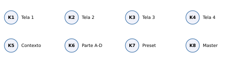
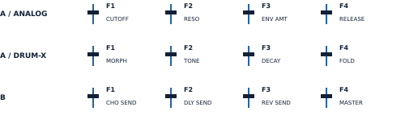
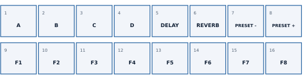
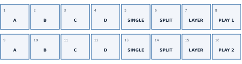
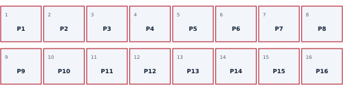
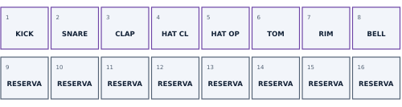

# SMKSYNTH 1.0.0 - Guia rápido

[PDF](pdf/SMKSYNTH-1.0.0-Quick-Start-PT.pdf) · [Português](QUICKSTART.md) · [English](QUICKSTART.en.md)

Referência: firmware 1.0.0, SMK-37 Pro_19618.

## Índice

- Quick start / 1. Primeiros passos
- Quick start / 2. Favoritos e Split/Layer
- Quick start / 3. Patterns e bateria
- Quick start / 4. Gravar, salvar e recuperar

## Desenvolvimento com IA

Desenvolvido com IA: Marcus Padrini definiu e orientou a experiência, criou os patterns e testou no instrumento. O ChatGPT (OpenAI) contribuiu com soluções técnicas e gerou e revisou código, ferramentas, documentação e gráficos. Engines originais: autores em CREDITS.md. Sem endosso da OpenAI.

## Quick start / 1. Primeiros passos

SMKSYNTH 1.0.0 - M-VAVE SMK-37 Pro. Use este guia depois de instalar. Para primeira instalação, use somente o firmware oficial V016; a instalação substitui o banco. Salve e exporte seu trabalho antes de retornar ao firmware oficial.

1. Ajuste K8/master para um volume adequado e aperte PLAY.
2. K6 seleciona A-D; K7 troca o preset da parte.
3. KNOB BANK percorre Performance > Split/Layer > Patterns; Drum Pads entra no ciclo se a parte selecionada é DRUM-X.
4. No banco Patterns, toque P1-P5 para os exemplos. P6-P16 estão livres.
5. PLAY para. Segure KNOB BANK 0,7 s para voltar a Performance/Favoritos.

K1-K4 seguem a tela. K5: tempo na Performance; LEVEL/OCT em Split/Layer; página em STEPS; pattern nas outras vistas SEQ/Mixer. FADER BANK troca apenas os faders. Bank B F1-F3 usam pickup: mova até cruzar o valor salvo. F4 Bank B = K8/master.

Os cinco exemplos começam a 90 BPM. Há oito favoritos e nenhum preset pessoal extra. PLAY/REC e escolha de engine preservam o banco de pads; SEQ solicita explicitamente os steps.

## Quick start / 2. Favoritos e Split/Layer

### Banco 1 - Performance/Favoritos

1-4: parte A-D. 5/6: send delay/reverb on/off. 7/8: preset anterior/próximo. 9-16: oito favoritos. Toque para recuperar na parte selecionada; segure 0,7 s para capturar. Pare e solte notas/sustain; aguarde FAVOURITES SAVED.

### Banco 2 - Split/Layer

1. Na mesma fileira, segure uma parte A-D e toque outra para formar o par. Use duas partes ANALOG.
2. Escolha SINGLE, SPLIT ou LAYER. K4 ajusta ponto de split.
3. K5 alterna K2/K3 entre níveis e oitavas das duas partes.
4. Pad 8 ou 16 seleciona a linha tocada (branco forte). Editar a outra linha não a ativa.
5. Salve o pattern para guardar ambas as configurações e a linha ativa.

K6 escolhe a parte gravada. BT salva preset; não substitui o salvamento de pattern/cena.

## Quick start / 3. Patterns e bateria

### Banco 3 - Patterns/Cenas

Toque carrega. Durante PLAY, a troca é agendada para o próximo compasso. Segure 0,7 s para salvar o pattern atual nessa posição. Se estiver ocupada, toque no mesmo pad em até 4 s para confirmar OVERWRITE; outro pad/PATCH cancela. Pare e aguarde a conclusão da escrita.

Vermelho: ocupado; vermelho muito fraco: vazio; azul: selecionado; azul piscando: próximo; vermelho piscando: confirmar. O pattern guarda sequência, quatro sons, mix e Split/Layer. Não há save automático ao trocar.

### Banco 4 - Drum Pads

1. K6 escolhe a parte. GLOBE até PART SETUP; K1 = DRUM-X e K2 = kit.
2. KNOB BANK até Drum Pads. A escolha de kit não ativa esse banco automaticamente.
3. Pads 1-8 tocam com velocity; 9-16 são reservados. Violeta em repouso, branco no toque e nos hits da sequência.
4. PLAY, depois REC: grave ao vivo pelos pads. REC encerra a gravação; PLAY para.

Em ANALOG, um banco Drum Pads já selecionado fica inativo. Volte a DRUM-X ou use KNOB BANK.

## Quick start / 4. Gravar, salvar e recuperar

| Botão | Uso imediato |
| --- | --- |
| PATCH | Toque: Performance; na Performance abre Mixer; no Mixer percorre as sete linhas. Segure 0,7 s: volta à Performance. |
| PARA | Toque: páginas de síntese; em STEPS limpa o step e avança (DRUM: limpa o hit da lane). Segure: edição/erase. |
| CHORD | ANALOG: FILTER ENV / AMP ENV. DRUM-X: DRUM SOUND. |
| NOTE REPEAT | ANALOG: LFO / LFO DEST / LFO +. DRUM-X redireciona para DRUM SOUND. |
| ARP | Abre ARP. Novo toque nessa página alterna HOLD da parte. |
| SCALE | Segure em STEPS ANALOG: STEP+. Na página GLOBAL, toque alterna SYNC AUTO / INTERNAL. |
| GLOBE | Toque: GLOBAL > POLYPHONY > OUTPUT > PART SETUP. Segure: teclas para start/stop, mute, solo e tap tempo. |
| FX | Toque: CHORUS > DELAY > REVERB > DRIVE. Segure: K1/K2/K3 retornos chorus/delay/reverb; K4 tempo do delay. |
| SEQ | Toque: vistas do sequenciador e posse explícita dos pads de steps. Segure: teclas brancas viram steps. |
| REC | Toque: arma parado; em execução liga/desliga gravação. Segure mais de 1,2 s: apaga a track selecionada. |

1. Gravação ao vivo: selecione K6, PLAY e REC; toque; REC encerra.
2. Passo a passo ANALOG: PLAY parado, REC apagado, SEQ > STEPS. Toque nota/acorde e solte para avançar. K1 move o step; deixe vazio para pausa.
3. Se LENGTH = OFF, use TRACKS K3 para ligar a track.
4. Salvar som: BT toque. Save As: segure BT, escolha K7, confirme BT. Salvar sequência/cena: segure pad do banco Patterns.
5. Para backup, salve no instrumento e espere a conclusão. Pare PLAY/REC e solte notas/sustain. Exporte na ferramenta web.
6. Restauração substitui todo o banco: exporte o atual, escolha o .smksynth e confirme. RESTORE PENDING exige o mesmo arquivo.

REC segurado por mais de 1,2 s apaga a track selecionada. Para transposição persistente: SEQ > TRANSPOSE K1 liga a captura; K2 ajusta, K3 zera. Performance K4 KEY TR desliga captura, sem zerar o valor.

## Links

- [Site](https://4t59m4f784-creator.github.io/SMKSYNTH/)
- [Instalador](https://4t59m4f784-creator.github.io/SMKSYNTH/install/)
- [Simulador](https://4t59m4f784-creator.github.io/SMKSYNTH/simulator/)
- [Backup](https://4t59m4f784-creator.github.io/SMKSYNTH/backup/)

[GitHub](https://github.com/4t59m4f784-creator/SMKSYNTH)
