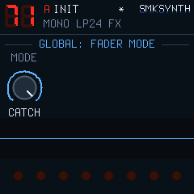
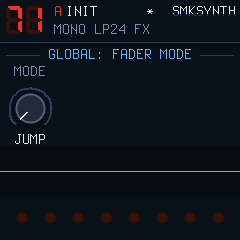

# SMKSYNTH 1.0.1-ct1 — teste dos controles / controls candidate

**Build para validação física. Não é a release estável.**

## Português

### Instalar e voltar

1. Com o SMKSYNTH 1.0.0 instalado, exporte seu banco na [ferramenta de backup](https://4t59m4f784-creator.github.io/SMKSYNTH/backup/) e guarde o arquivo.
2. Baixe [SMKSYNTH-1.0.1-ct1-SMK37-Pro.fwsc](SMKSYNTH-1.0.1-ct1-SMK37-Pro.fwsc) e selecione esse arquivo no **M-UPGRADE**, com o teclado conectado por USB e alimentação estável. Feche o simulador e outros aplicativos MIDI durante a instalação.
3. A build mostra **1.0.1-ct1** no boot. A identidade USB permanece `SMK-37 Pro_19618` para continuar compatível com o backup existente.
4. O pacote usa o loader de atualização que exige e preserva o banco SMK16P1. **Não retorne ao firmware oficial V016 para este teste.** Ele não é um pacote de primeira instalação.
5. Para retornar, instale [SMKSYNTH-1.0.0-return-preserve-bank.fwsc](SMKSYNTH-1.0.0-return-preserve-bank.fwsc) pelo mesmo procedimento. O aplicativo é exatamente o da release pública 1.0.0, com o loader que preserva o banco. O instalador público de primeira instalação não é o caminho de retorno deste teste.

### FADER MODE

Pressione **GLOBE** até **GLOBAL: FADER MODE**. K1 à esquerda seleciona **JUMP**; à direita, **CATCH**. A página foi acrescentada depois de PART SETUP no ciclo existente. As telas anteriores mantêm a ordem.

- **JUMP:** o próximo movimento aplica a posição física do fader.
- **CATCH:** o fader precisa alcançar/cruzar o valor atual antes de alterar o parâmetro. Novos valores e contextos rearmam a captura. Se já estiver no valor correto, o próximo movimento pode acompanhá-lo.
- Bancos antigos sem configuração explícita começam em **CATCH**. O modo é global; trocar patterns não o substitui. Para persistir, use o salvamento manual **BT/SAVE** já existente e aguarde a conclusão. Não foi acrescentado salvamento automático.
- Presets, favoritos, cenas e patterns mantêm os mesmos formatos. Os oito encoders continuam relativos; K8 mantém o controle do master físico.

| Fader | Banco A / ANALOG | Banco A / DRUM-X | Banco B |
|---|---|---|---|
| F1 | Cutoff | Morph | Chorus send da parte |
| F2 | Resonance | Tone | Delay send da parte |
| F3 | Filter envelope amount | Decay | Reverb send da parte |
| F4 | Amp Release | Fold | Master físico, igual a K8 |

 

### Conferência no teclado

- Abra AMP ENV e FILTER ENV; anote Attack. Sem tocar nos controles, aguarde e mude páginas, partes, favoritos, patterns e bancos. Confirme que Attack não muda fora de um recall, MIDI ou automação gravada.
- Em CATCH, deixe cada fader longe do valor salvo: mova sem cruzar, cruze e continue. Repita nos dois bancos, incluindo master e sends. Altere o valor por encoder e confirme a nova captura.
- Em JUMP, confira a resposta no primeiro movimento e a ausência de alterações com o fader parado.
- Confirme os oito encoders, mixer, FX, troca de presets/partes, troca imediata e agendada de pattern. Uma navegação simultânea descarta o delta de parâmetro pertencente ao contexto anterior; o próximo detent deve responder normalmente.
- Salve o modo, reinicie e confira-o. Exporte um backup e teste seus patterns/favoritos habituais.

A reprodução da falha do decoder em teste não confirma qual foi a origem da alteração de Attack observada no instrumento. Os detalhes estão em [CONTROLS-CT1.md](../../docs/CONTROLS-CT1.md).

## English

This candidate requires physical validation. Export your bank first. Install the CT1 `.fwsc` through M-UPGRADE over USB **from an existing SMKSYNTH 1.0.0 installation**. Do not reinstall stock V016. CT1 displays `1.0.1-ct1` at boot and retains USB identity `SMK-37 Pro_19618` for compatibility with the existing backup tool.

The candidate and the supplied return package both require/preserve the existing SMK16P1 bank. The return package contains the exact public 1.0.0 application. Do not use the public first-install package to roll back this test.

Press **GLOBE** until **GLOBAL: FADER MODE**. Turn K1 left for **JUMP**, right for **CATCH**. JUMP applies the physical position on movement; CATCH waits until the fader reaches/crosses the current value. Value or context changes rearm pickup. If already aligned, movement can follow immediately. Legacy banks default to CATCH. Save through the existing manual BT/SAVE workflow to persist it. Pattern recall does not replace this global mode.

All four faders, including sends and physical master, obey the chosen mode. The eight encoders remain relative. Validate both Attack pages, idle controls, mixer/FX, both fader banks, part/preset/favourite recalls, immediate and queued patterns, mode save/reboot and your existing bank. Software tests passed; physical results remain pending.

Development and technical implementation with ChatGPT / OpenAI under Marcus Padrini's direction; upstream credits and licences remain in [CREDITS.md](../../CREDITS.md).
